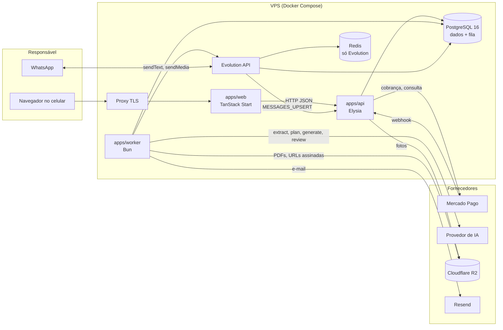
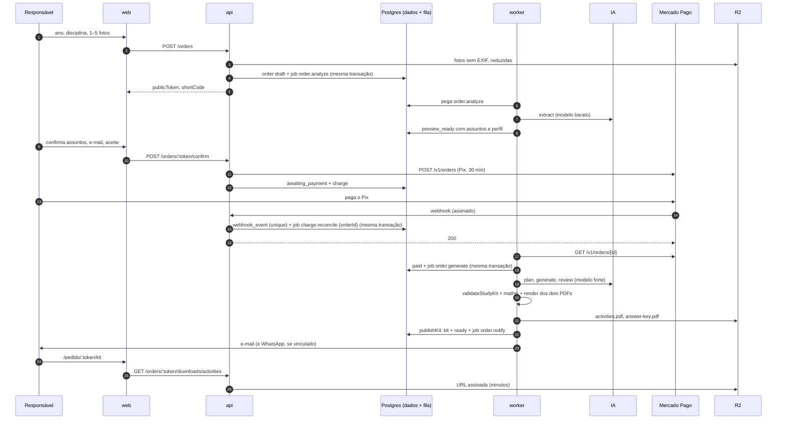

# Arquitetura técnica

**Versão:** 1.1 · **Data:** 2026-10-22 · **Fonte de produto:** PRD §8–9 (`docs/product/product-doc-v1.md`), design doc §6 (`docs/design/design-doc-v1.md`) · **Decisões:** ADR-0002 a ADR-0007

Este documento descreve como o Gizito é dividido em processos e pacotes, por onde os dados passam e quais fronteiras não podem ser cruzadas. Regras de detalhe por área estão em `.claude/rules/`; invariantes no `CLAUDE.md`.

## 1. Visão geral



Três processos e três pacotes:

| Unidade | Papel | Conhece |
|---|---|---|
| `apps/web` | landing, fluxo de compra, páginas do pedido (SSR) | só a API, por HTTP; schemas do `core` para validar respostas |
| `apps/api` | upload, pedidos, prévia, cobrança Pix, webhooks, downloads, admin, `/health` | `core`, `db`, `integrations` (gateway, storage) |
| `apps/worker` | consumidor da fila: extração, planejamento, geração, validação, revisão, render, publicação, notificações, reconciliação, retenção | `core`, `db`, `integrations` (IA, storage, e-mail, WhatsApp, mathjs, KaTeX, Playwright) |
| `packages/core` | domínio puro: constantes, enums, máquina de estados, schemas, validações pedagógicas, taxonomia, interfaces | `zod`, nada mais |
| `packages/db` | schema Drizzle, migrations, conexão, fila, transações obrigatórias, test-helpers | `core`, Drizzle, Postgres |
| `packages/integrations` | adaptadores reais e fakes das interfaces do `core` | `core`, SDKs dos fornecedores |

## 2. Fluxo principal



Pontos que não mudam:

- A API **nunca** chama IA; só enfileira. A IA só roda no worker, atrás de `AiProvider`, com saída validada por Zod e custo gravado em `ai_call`.
- `awaiting_payment → paid` só depois de **consultar o gateway**; marcar pago e enfileirar `order.generate` na mesma transação, idempotente por `gateway_payment_id` (ver `jobs.md`). O webhook do gateway só valida a assinatura, registra o evento e enfileira `charge.reconcile` para aquele pedido; a consulta e a transição acontecem no worker, pelo mesmo caminho da reconciliação periódica.
- Nenhuma etapa depende do WhatsApp: e-mail é obrigatório e `WHATSAPP_ENABLED=false` desliga botão, webhook e envios sem afetar o resto.
- `ready` só com os **dois PDFs** no storage e as validações críticas verdes (`publishKit`).
- Download sempre por URL assinada de minutos gerada no clique; o link do pedido (token) é de vida longa e só dá acesso ao status e às ações daquele pedido.

## 3. Camadas dentro de cada app

```
handler (HTTP ou job) → service → Drizzle (packages/db)
```

- Handlers validam entrada com Zod, chamam um service e formatam a resposta. Não tocam banco.
- Services contêm a regra: carregam o pedido, chamam `transitionOrder` do core **dentro da transação**, gravam efeitos, enfileiram jobs. Não conhecem HTTP nem o nome do job que os chamou.
- Adaptadores (`integrations`) traduzem fornecedor ↔ tipos do core; não decidem estado.
- Sem camada de repository: Drizzle já é a abstração de consulta.

## 4. Dados e armazenamento

- PostgreSQL 16 guarda pedidos, fotos (metadados), cobranças, kits, chamadas de IA, eventos de webhook, notificações, tickets e **a fila de jobs** (ADR-0003). Modelo em `data-model.md`.
- Cloudflare R2, bucket privado, guarda fotos (30 dias) e PDFs (12 meses); keys `photos/{orderId}/{photoId}.jpg`, `photos/{orderId}/{photoId}-thumbnail.jpg` e `orders/{orderId}/kits/{kitId}/{activities,answer-key}.pdf`. O prefixo `photos/` recebe a regra de ciclo de vida de 30 dias (ADR-0012). Adaptador com `aws4fetch`; no dev e na CI, MinIO do compose.
- Redis existe só para a Evolution API. Nenhuma app lê Redis.
- Nada de conteúdo pessoal em logs: `orderId`, etapa, duração, custo e códigos de erro são o vocabulário dos logs (invariante 9).

## 5. Ambientes

| Ambiente | Como sobe | Observações |
|---|---|---|
| Local | `docker compose up -d` (Postgres 5433, Redis 6379, MinIO 9000 com o console em 9001 e o bucket `gizito`, Evolution 8080, só em `127.0.0.1`) + `bun run dev` | `.env` a partir de `.env.example`; `PAYMENT_GATEWAY=fake`, `WHATSAPP_ENABLED=false` por padrão |
| Testes | unit sem Docker (`bun run test`); integração com Postgres real via `@gizito/db/test-helpers` (`bun run test:integration`); regressão pedagógica com chave de IA (`bun run test:pedagogy`), fora do CI | `mock.module` do Bun é process-wide, por isso scripts separados |
| Produção (F2-13) | um VPS, Compose com web, api, worker, postgres, redis, evolution e proxy TLS; só 80/443 públicos; migrations no deploy; `pg_dump` diário para R2 | Evolution e Postgres nunca expostos; alertas de fila parada, WhatsApp desconectado e taxa de `failed` |

## 6. Segurança e privacidade, em uma página

- Comprador adulto; nunca nome da criança, da escola ou telefone da criança. E-mail e telefone do responsável só com aceite, mascarados no admin, removíveis.
- Foto, texto extraído, observação, assunto "outro", mensagem de WhatsApp e corpo de webhook são dados, nunca instrução: delimitados no prompt, limitados em tamanho, fora dos logs.
- Webhooks validam assinatura antes de qualquer efeito; duplicado responde 200 sem efeito.
- Rate limit na prévia gratuita (IP + cookie de dispositivo) e teto de custo de IA por pedido (`MAX_AI_COST_CENTS_PER_ORDER`).
- Segredos só por variável de ambiente lida em `config.ts`; `.env` nunca entra no git nem é lido por agentes.

## 7. Observabilidade

- Logs estruturados (JSON) com `orderId`, rota ou `jobName`, `stage`, duração, tokens, custo, `outcomeCode`.
- `ai_call` por chamada de IA: modelo, versão do prompt, tokens, custo, duração, resultado. Sem conteúdo.
- `/health` em api e worker; métricas mínimas: fila (tamanho e idade do job mais antigo), taxa de `failed`, custo por pedido, estado da conexão do WhatsApp.

## Histórico

- **1.0 (2026-10-15):** versão inicial (F0-03), derivada do PRD §9, do design doc §6 e das decisões de F0-01, F0-02 e F0-04.
- **1.1 (2026-10-22):** F2-01 e ADR-0012: fotos no prefixo `photos/` com miniatura, adaptador R2 com `aws4fetch`, MinIO no ambiente local.
