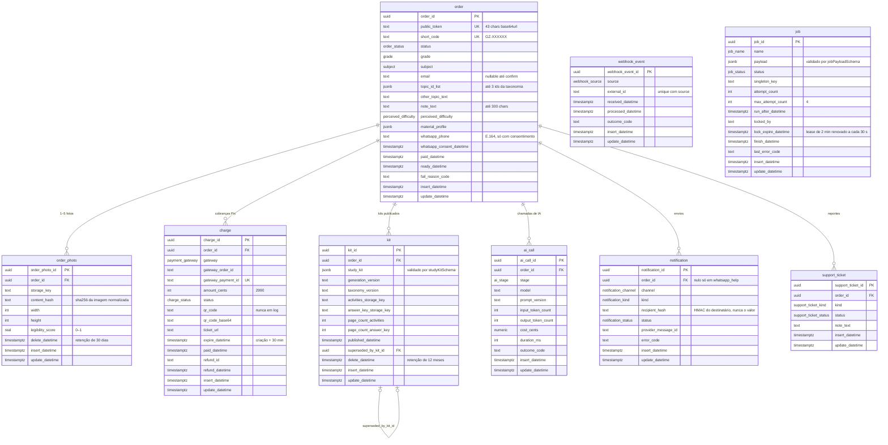

# Modelo de dados

**Versão:** 1.4 · **Data:** 2026-10-20 · **Fonte:** PRD §5, §6, §9; `.claude/rules/database.md`; ADR-0008, ADR-0009 · **Código:** `packages/db` (F0-05, F0-06), enums e schemas em `packages/core` (F0-04)

PostgreSQL 16 com Drizzle. Single-tenant: não há `store_id` nem RLS; o isolamento é por pedido, e toda leitura pública passa pelo `public_token`.

## 1. Convenções

- Tabelas em snake_case **singular**; export Drizzle camelCase singular (`order`, `orderPhoto`, `charge`, `kit`, `aiCall`, `webhookEvent`, `notification`, `supportTicket`, `job`).
- PK `{tabela}_id` (`uuid`, `gen_random_uuid()`), nunca `id`; FK com o mesmo nome da PK e `onDelete` explícito.
- Timestamps `timestamptz` com sufixo `_datetime`, nunca `_at`; `insert_datetime` e `update_datetime` em toda tabela.
- Enums como `pgEnum` cujos valores vêm dos arrays `*List` do core (`orderStatusList`, `chargeStatusList`, `gradeList`, `subjectList`, `perceivedDifficultyList`, `notificationChannelList`, `notificationKindList`, `notificationStatusList`, `webhookSourceList`, `supportTicketKindList`, `supportTicketStatusList`, `aiStageList`, `paymentGatewayList`, `jobNameList`, `jobStatusList`).
- `order` é palavra reservada em SQL: o Drizzle cita identificadores nas queries geradas; SQL manual precisa de `"order"`.
- Ids do Postgres validados com `z.guid()` (não `z.uuid()`, lesson de 2026-10-14).
- Migration aplicada nunca se edita; correção vai em migration nova.
- `update_datetime` é mantido pelo trigger `set_update_datetime` (`BEFORE UPDATE`) em toda tabela, definido como SQL customizado na migration; tabela nova precisa do seu trigger (o teste `migrations.test.ts` do `db` falha sem ele).
- Colunas `jsonb` usam a coluna própria de `src/schema/jsonb.ts`, nunca o `jsonb` do `drizzle-orm`: com o driver `bun-sql` ele grava string JSON em vez de objeto (lessons de 2026-10-15). O teste de convenções exige a coluna própria e os testes de integração leem `jsonb_typeof`.
- FKs para `order` são `ON DELETE RESTRICT` (o pedido nunca é apagado; remoção LGPD anonimiza, §5); `kit.superseded_by_kit_id` é `ON DELETE SET NULL`.
- Checks no banco: `amount_cents > 0`; `whatsapp_phone` e `whatsapp_consent_datetime` nulos ou preenchidos juntos; `topic_id_list` é array e, somado ao "outro", cobre até `MAX_TOPIC_COUNT` assuntos; `notification.order_id` nulo só na ajuda do WhatsApp; `recipient_hash` com 64 hex; `legibility_score` em 0–1; `width`, `height` e `page_count_*` > 0; contagens de tokens, `cost_cents` e `duration_ms` ≥ 0.
- `ai_call.cost_cents` é em **centavos de dólar**, a moeda da fatura do provedor de IA (ADR-0011); `input_token_count` soma os tokens sem cache, os escritos e os lidos do cache. Comparação com valores em reais (preço do kit, metas de custo) converte no relatório.

## 2. Diagrama

A fila é a tabela `job` (ADR-0008, migration `0001_fila`), sem FK: o pedido, quando existe, está no `payload`. `status` vai de `pending` a `active` no claim e termina em `completed` ou `failed`; falha transitória volta a `pending` com `run_after_datetime` adiado. O check `payload->>'name' IS NOT DISTINCT FROM name` recusa payload sem `name`, com outro `name` ou que não seja objeto.

## 3. Índices obrigatórios

| Tabela | Índice | Uso |
|---|---|---|
| `order` | unique `public_token` | toda leitura pública |
| `order` | unique `short_code` | vínculo de WhatsApp |
| `order` | `(status, update_datetime)` | reconciliação, retenção, admin |
| `order` | `email` | busca no admin |
| `order` | `whatsapp_phone` (parcial, não nulo) | SAIR/PARAR e vínculo repetido |
| `order_photo` | `order_id`; `(delete_datetime, insert_datetime)`; `content_hash` | listagem; purge; cache de extração por hash (F1-02) |
| `charge` | `order_id`; unique `gateway_payment_id` (parcial, não nulo); unique `(gateway, gateway_order_id)` (parcial, não nulo); `(status, expire_datetime)` | idempotência do pagamento; localizar a cobrança pelo webhook; reconciliação |
| `kit` | `order_id`; `(delete_datetime, published_datetime)` | download; purge |
| `ai_call` | `order_id` | custo por pedido |
| `webhook_event` | unique `(source, external_id)` | idempotência |
| `notification` | unique `(order_id, kind, channel, recipient_hash)`; `(recipient_hash, kind, insert_datetime)` | um envio por evento e destinatário; retry de envio atualiza a linha (`failed → pending → sent`), nunca insere outra; e-mail corrigido pelo admin é outro destinatário; limite de uma ajuda por 24 h por número |
| `support_ticket` | `order_id`; `status` | admin |
| `job` | parciais `(name, run_after_datetime, insert_datetime)` com `pending`, `(lock_expire_datetime)` com `active` e `(finish_datetime)` com `failed`; unique parcial `(name, singleton_key)` com chave não nula e status `pending` ou `active` | claim; recuperação de lock vencido; métricas do `/health`; agendador sem duplicar. Os parciais não indexam os jobs `completed`, que só saem com o expurgo da F2-06 |

## 4. O que cada tabela não guarda

- `order`: nome da criança, escola, turma, CPF. `whatsapp_phone` só com `whatsapp_consent_datetime`.
- `order_photo`: a imagem (fica no R2, privada); EXIF já removido antes do upload.
- `ai_call`: prompt, resposta, texto extraído. Só números e códigos.
- `webhook_event`: corpo bruto. Só identificação e resultado.
- `charge`: o `qr_code` existe na tabela (o web precisa exibi-lo) mas nunca vai para log.
- `job`: o payload de `whatsapp.inbound` carrega telefone e texto só enquanto o job pode rodar; ao terminar, fica reduzido a `name` e `webhookEventId` (`personalDataJobRetainedFieldMap` do core).

## 5. Retenção e soft delete

- Fotos: `retention.purge` apaga do storage após `PHOTO_RETENTION_DAYS` (30) e grava `delete_datetime`; a linha fica.
- PDFs e `study_kit`: após `KIT_RETENTION_MONTHS` (12), apaga do storage, grava `delete_datetime` e limpa `study_kit`; `ai_call` permanece para métricas.
- Remoção a pedido do titular: admin apaga `email`, `whatsapp_phone`, fotos e PDFs, mantendo o pedido como registro contábil anonimizado.
- As funções de prazo (`photoDeleteDeadline`, `kitDeleteDeadline`) estão no core e recebem o relógio por parâmetro.

## 6. Transações obrigatórias (`packages/db`)

Toda conexão do pool (`createDatabase`) sai com `statement_timeout` de 30 s, `lock_timeout` de 10 s, `idle_in_transaction_session_timeout` de 60 s e `connectionTimeout` de 5 s; o `migrate.ts` desliga só o `statement_timeout`. `pingDatabase` e `getQueueMetrics` têm teto de 2 s (`DatabaseTimeoutError`). Uma transação parada segurando `FOR UPDATE` no pedido é derrubada pelo banco em vez de travar as escritas daquele pedido.

- `markOrderPaidAndEnqueue(tx, { orderId, chargeId, gatewayPaymentId, paidDatetime, webhookEventId? }, { now? })`: trava `order`, `charge` e o `webhook_event` informado com `FOR UPDATE`; a decisão é `decidePaymentConfirmation` do core. `paid`: grava o status de destino da máquina e `paid_datetime`, marca a cobrança `paid` com o `gateway_payment_id`, expira as demais cobranças `pending` do pedido e enfileira `order.generate`. Cobrança já `paid` ou `refunded` com o mesmo pagamento: no-op (`already_paid`). Outra cobrança paga com o pedido já `paid` ou posterior: marca a cobrança `paid`, abre `support_ticket` `duplicate_payment` e não muda o estado. Com `webhookEventId`, grava `processed_datetime` e `outcome_code` (`paid`, `already_paid`, `duplicate_payment`). Erros (`OrderNotFoundError`, `ChargeNotFoundError`, `WebhookEventNotFoundError`, `GatewayPaymentInUseError` quando o pagamento já está em outra cobrança, `ChargePaymentMismatchError`, `InvalidTransitionError`) voltam como `Result` antes de qualquer escrita; só uma corrida em que outra transação grave o mesmo `gateway_payment_id` entre a checagem e a escrita cai no unique e lança, com rollback.
- `republishKit(tx, { orderId, kit })` (admin, F2-11): insere o kit novo com as duas keys e grava `superseded_by_kit_id` no anterior; sem transição de estado, porque o pedido já está `ready`.
- `publishKit(tx, { orderId, kitId, studyKit, generationVersion, taxonomyVersion, activitiesStorageKey, answerKeyStorageKey, pageCountActivities, pageCountAnswerKey }, { now? })`: a entrada passa em `publishKitInputSchema` do core (as duas keys iguais a `kitStorageKey` do próprio kit); trava o pedido, `transitionOrder(status, "kit_published")`, insere `kit` com `published_datetime`, grava `ready_datetime` e enfileira `order.notify` `kit_ready`. Transição inválida (por exemplo reembolso durante `processing`) volta como erro sem inserir kit. Nunca com uma key só.

## Histórico

- **1.0 (2026-10-15):** versão inicial (F0-03). Colunas `kit.delete_datetime` e `charge.refund_datetime` e índices derivados das rules; a migration 0001 (F0-05) é a implementação.
- **1.1 (2026-10-15):** F0-05 implementa o modelo em `packages/db/drizzle/0000_fundacao.sql` (numeração nativa do drizzle-kit: a "migration 0001" da 1.0 é esta); convenções de trigger, `onDelete` e checks acrescentadas em §1; `ai_call.cost_cents` é `numeric(12,6)` lido como número.
- **1.2 (2026-10-15):** F0-06 acrescenta a tabela `job` (diagrama, índices, o que não guarda), a convenção da coluna `jsonb` própria e as assinaturas reais de `markOrderPaidAndEnqueue` e `publishKit` em §6.
- **1.3 (2026-10-19):** revisão da F0 (migration `0002_revisao_f0`): índices parciais da `job`; unique de `(gateway, gateway_order_id)`; índices de `whatsapp_phone` e `content_hash`; check de `topic_id_list` contando o "outro"; `notification` com `recipient_hash`, `order_id` nulo só na ajuda e unique por destinatário; timeouts do pool em §6.
- **1.4 (2026-10-20):** F1-05: `ai_call.cost_cents` em centavos de dólar e `input_token_count` com os tokens de cache (§1, ADR-0011).
