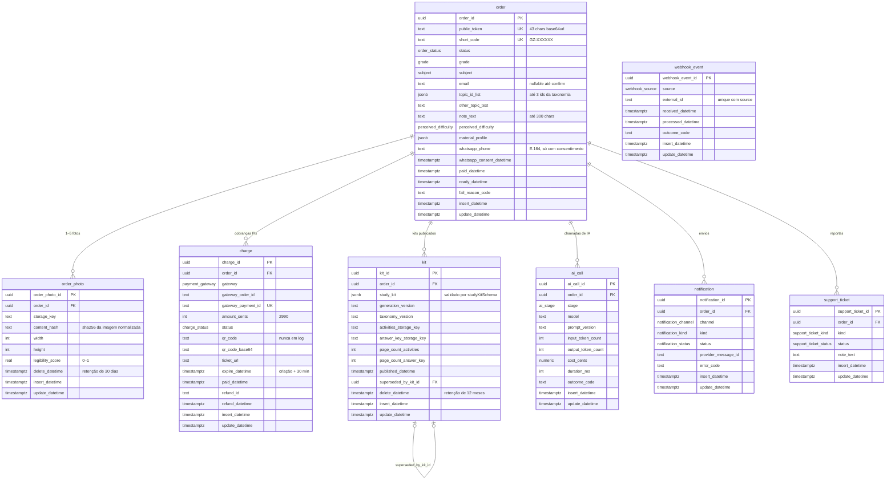

# Modelo de dados

**Versão:** 1.1 · **Data:** 2026-10-15 · **Fonte:** PRD §5, §6, §9; `.claude/rules/database.md` · **Código:** `packages/db` (F0-05), enums e schemas em `packages/core` (F0-04)

PostgreSQL 16 com Drizzle. Single-tenant: não há `store_id` nem RLS; o isolamento é por pedido, e toda leitura pública passa pelo `public_token`.

## 1. Convenções

- Tabelas em snake_case **singular**; export Drizzle camelCase singular (`order`, `orderPhoto`, `charge`, `kit`, `aiCall`, `webhookEvent`, `notification`, `supportTicket`).
- PK `{tabela}_id` (`uuid`, `gen_random_uuid()`), nunca `id`; FK com o mesmo nome da PK e `onDelete` explícito.
- Timestamps `timestamptz` com sufixo `_datetime`, nunca `_at`; `insert_datetime` e `update_datetime` em toda tabela.
- Enums como `pgEnum` cujos valores vêm dos arrays `*List` do core (`orderStatusList`, `chargeStatusList`, `gradeList`, `subjectList`, `perceivedDifficultyList`, `notificationChannelList`, `notificationKindList`, `notificationStatusList`, `webhookSourceList`, `supportTicketKindList`, `supportTicketStatusList`, `aiStageList`, `paymentGatewayList`).
- `order` é palavra reservada em SQL: o Drizzle cita identificadores nas queries geradas; SQL manual precisa de `"order"`.
- Ids do Postgres validados com `z.guid()` (não `z.uuid()`, lesson de 2026-10-14).
- Migration aplicada nunca se edita; correção vai em migration nova.
- `update_datetime` é mantido pelo trigger `set_update_datetime` (`BEFORE UPDATE`) em toda tabela, definido como SQL customizado na migration; tabela nova precisa do seu trigger (o teste `migrations.test.ts` do `db` falha sem ele).
- FKs para `order` são `ON DELETE RESTRICT` (o pedido nunca é apagado; remoção LGPD anonimiza, §5); `kit.superseded_by_kit_id` é `ON DELETE SET NULL`.
- Checks no banco: `amount_cents > 0`; `whatsapp_phone` e `whatsapp_consent_datetime` nulos ou preenchidos juntos; `legibility_score` em 0–1; `width`, `height` e `page_count_*` > 0; contagens de tokens, `cost_cents` e `duration_ms` ≥ 0.

## 2. Diagrama

A tabela da fila (`job` própria ou as do pg-boss no schema `pgboss`) é definida em F0-06 (ADR-0008) e guarda `name` (de `jobNameList`), `payload` (validado por `jobPayloadSchema`), estado, tentativas e `run_after_datetime`.

## 3. Índices obrigatórios

| Tabela | Índice | Uso |
|---|---|---|
| `order` | unique `public_token` | toda leitura pública |
| `order` | unique `short_code` | vínculo de WhatsApp |
| `order` | `(status, update_datetime)` | reconciliação, retenção, admin |
| `order` | `email` | busca no admin |
| `order_photo` | `order_id`; `(delete_datetime, insert_datetime)` | listagem; purge |
| `charge` | `order_id`; unique `gateway_payment_id` (parcial, não nulo); `(status, expire_datetime)` | idempotência do pagamento; reconciliação |
| `kit` | `order_id`; `(delete_datetime, published_datetime)` | download; purge |
| `ai_call` | `order_id` | custo por pedido |
| `webhook_event` | unique `(source, external_id)` | idempotência |
| `notification` | unique `(order_id, kind, channel)` | um envio por evento; retry de envio atualiza a linha (`failed → pending → sent`), nunca insere outra |
| `support_ticket` | `order_id`; `status` | admin |

## 4. O que cada tabela não guarda

- `order`: nome da criança, escola, turma, CPF. `whatsapp_phone` só com `whatsapp_consent_datetime`.
- `order_photo`: a imagem (fica no R2, privada); EXIF já removido antes do upload.
- `ai_call`: prompt, resposta, texto extraído. Só números e códigos.
- `webhook_event`: corpo bruto. Só identificação e resultado.
- `charge`: o `qr_code` existe na tabela (o web precisa exibi-lo) mas nunca vai para log.

## 5. Retenção e soft delete

- Fotos: `retention.purge` apaga do storage após `PHOTO_RETENTION_DAYS` (30) e grava `delete_datetime`; a linha fica.
- PDFs e `study_kit`: após `KIT_RETENTION_MONTHS` (12), apaga do storage, grava `delete_datetime` e limpa `study_kit`; `ai_call` permanece para métricas.
- Remoção a pedido do titular: admin apaga `email`, `whatsapp_phone`, fotos e PDFs, mantendo o pedido como registro contábil anonimizado.
- As funções de prazo (`photoDeleteDeadline`, `kitDeleteDeadline`) estão no core e recebem o relógio por parâmetro.

## 6. Transações obrigatórias (`packages/db`)

- `markOrderPaidAndEnqueue(tx, { orderId, chargeId, gatewayPaymentId, paidDatetime })`: `transitionOrder(status, "payment_confirmed")`, atualiza `order` e `charge`, marca como `expired` as demais cobranças `pending` do pedido, insere `order.generate`. Repetição com o mesmo `gateway_payment_id` é no-op. Pagamento confirmado de **outra** cobrança de pedido já `paid` ou posterior não muda estado: abre `support_ticket` `duplicate_payment` para reembolso manual.
- `republishKit(tx, { orderId, kit })` (admin): insere o kit novo com as duas keys e grava `superseded_by_kit_id` no anterior; sem transição de estado, porque o pedido já está `ready`.
- `publishKit(tx, { orderId, kit })`: insere `kit` com as **duas** storage keys, `transitionOrder(status, "kit_published")`, `ready_datetime`, insere `order.notify`. Nunca com uma key só.

## Histórico

- **1.0 (2026-10-15):** versão inicial (F0-03). Colunas `kit.delete_datetime` e `charge.refund_datetime` e índices derivados das rules; a migration 0001 (F0-05) é a implementação.
- **1.1 (2026-10-15):** F0-05 implementa o modelo em `packages/db/drizzle/0000_fundacao.sql` (numeração nativa do drizzle-kit: a "migration 0001" da 1.0 é esta); convenções de trigger, `onDelete` e checks acrescentadas em §1; `ai_call.cost_cents` é `numeric(12,6)` lido como número.
