# Modelo de dados

**Versão:** 1.9 · **Data:** 2026-10-22 · **Fonte:** PRD §5, §6, §9; `.claude/rules/database.md`; ADR-0008, ADR-0009 · **Código:** `packages/db` (F0-05, F0-06), enums e schemas em `packages/core` (F0-04)

PostgreSQL 16 com Drizzle. Single-tenant: não há `store_id` nem RLS; o isolamento é por pedido, e toda leitura pública passa pelo `public_token`.

## 1. Convenções

- Tabelas em snake_case **singular**; export Drizzle camelCase singular (`order`, `orderPhoto`, `charge`, `kit`, `aiCall`, `webhookEvent`, `notification`, `supportTicket`, `job`).
- PK `{tabela}_id` (`uuid`, `gen_random_uuid()`), nunca `id`; FK com o mesmo nome da PK e `onDelete` explícito.
- Timestamps `timestamptz` com sufixo `_datetime`, nunca `_at`; `insert_datetime` e `update_datetime` em toda tabela.
- Enums como `pgEnum` cujos valores vêm dos arrays `*List` do core (`orderStatusList`, `chargeStatusList`, `gradeList`, `subjectList`, `perceivedDifficultyList`, `notificationChannelList`, `notificationKindList`, `notificationStatusList`, `webhookSourceList`, `supportTicketKindList`, `supportTicketStatusList`, `aiStageList`, `paymentGatewayList`, `jobNameList`, `jobStatusList`).
- `order` é palavra reservada em SQL: o Drizzle cita identificadores nas queries geradas; SQL manual precisa de `"order"`.
- Ids do Postgres validados com `z.guid()` (não `z.uuid()`, lesson de 2026-10-14).
- Migration aplicada nunca se edita; correção vai em migration nova.
- `update_datetime` é mantido pelo trigger `set_update_datetime` (`BEFORE UPDATE`) em toda tabela, definido como SQL customizado na migration; tabela nova precisa do seu trigger (o teste `migrations.test.ts` do `db` falha sem ele).
- Colunas `jsonb` usam a coluna própria de `src/schema/jsonb.ts`, nunca o `jsonb` do `drizzle-orm`: com o driver `bun-sql` ele grava string JSON em vez de objeto (lessons de 2026-10-15). O teste de convenções exige a coluna própria e os testes de integração leem `jsonb_typeof`.
- FKs para `order` são `ON DELETE RESTRICT` (o pedido nunca é apagado; remoção LGPD anonimiza, §5); `kit.superseded_by_kit_id` é `ON DELETE SET NULL`.
- Checks no banco: `amount_cents > 0`; `whatsapp_phone` e `whatsapp_consent_datetime` nulos ou preenchidos juntos; `topic_id_list` é array e, somado ao "outro", cobre até `MAX_TOPIC_COUNT` assuntos; `notification.order_id` nulo só na ajuda do WhatsApp; `recipient_hash` com 64 hex; `legibility_score` em 0–1; `width`, `height` e `page_count_*` > 0; contagens de tokens, `cost_cents` e `duration_ms` ≥ 0; `order.analysis` nula em `analyzing` e com `outcome` `preview_ready` em `preview_ready` (`order_analysis_check`).
- `ai_call.cost_cents` é em **centavos de dólar**, a moeda da fatura do provedor de IA (ADR-0011); `input_token_count` soma os tokens sem cache, os escritos e os lidos do cache. Comparação com valores em reais (preço do kit, metas de custo) converte no relatório.

## 2. Diagrama

```mermaid
erDiagram
  order ||--o{ order_photo : "1–5 fotos"
  order ||--o{ charge : "cobranças Pix"
  order ||--o{ kit : "kits publicados"
  order ||--o{ ai_call : "chamadas de IA"
  order ||--o{ notification : "envios"
  order ||--o{ support_ticket : "reportes"
  kit o|--o| kit : "superseded_by_kit_id"

  extraction_cache {
    uuid extraction_cache_id PK
    text cache_key UK "hash da foto, ano, disciplina, taxonomia, prompt e modelo"
    jsonb extraction "photoExtractionSchema, já sanitizada"
    jsonb issue_list "avisos internos da sanitização"
    timestamptz expire_datetime "fim da retenção da foto que criou a entrada"
    timestamptz insert_datetime
    timestamptz update_datetime
  }
  preview_request {
    uuid preview_request_id PK
    text client_ip_hash "HMAC do IP normalizado"
    text device_hash "HMAC do cookie do dispositivo"
    timestamptz insert_datetime
    timestamptz update_datetime
  }
  order {
    uuid order_id PK
    text public_token UK "43 chars base64url"
    text short_code UK "GZ-XXXXXX"
    order_status status
    grade grade
    subject subject
    text email "nullable até confirm"
    jsonb topic_id_list "até 3 ids da taxonomia"
    text other_topic_text
    text note_text "até 300 chars"
    perceived_difficulty perceived_difficulty
    jsonb material_profile
    jsonb analysis "orderAnalysisSchema; nula com a análise pendente"
    text whatsapp_phone "E.164, só com consentimento"
    timestamptz whatsapp_consent_datetime
    timestamptz paid_datetime
    timestamptz ready_datetime
    text fail_reason_code
    timestamptz insert_datetime
    timestamptz update_datetime
  }
  order_photo {
    uuid order_photo_id PK
    uuid order_id FK
    int photo_index "0–4, ordem do envio"
    text storage_key "photos/{orderId}/{orderPhotoId}.jpg"
    text content_hash "sha256 da imagem normalizada"
    int width
    int height
    real legibility_score "0–1"
    timestamptz replaced_datetime "Trocar foto"
    timestamptz delete_datetime "retenção de 30 dias ou troca"
    timestamptz insert_datetime
    timestamptz update_datetime
  }
  charge {
    uuid charge_id PK
    uuid order_id FK
    payment_gateway gateway
    text gateway_order_id
    text gateway_payment_id UK
    int amount_cents "2990"
    charge_status status "paid e refunded exigem paid_datetime e gateway_payment_id; refunded exige refund_id e refund_datetime"
    text qr_code "nunca em log"
    text qr_code_base64 "nulo: o sandbox não devolve"
    text ticket_url
    timestamptz expire_datetime "criação + 30 min"
    timestamptz paid_datetime
    text refund_id
    timestamptz refund_datetime
    timestamptz insert_datetime
    timestamptz update_datetime
  }
  kit {
    uuid kit_id PK
    uuid order_id FK
    jsonb study_kit "validado por studyKitSchema"
    text generation_version
    text taxonomy_version
    text activities_storage_key
    text answer_key_storage_key
    int page_count_activities
    int page_count_answer_key
    timestamptz published_datetime
    uuid superseded_by_kit_id FK
    timestamptz delete_datetime "retenção de 12 meses"
    timestamptz insert_datetime
    timestamptz update_datetime
  }
  ai_call {
    uuid ai_call_id PK
    uuid order_id FK
    ai_stage stage
    text model
    text prompt_version
    int input_token_count
    int output_token_count
    numeric cost_cents
    int duration_ms
    text outcome_code
    timestamptz insert_datetime
    timestamptz update_datetime
  }
  webhook_event {
    uuid webhook_event_id PK
    webhook_source source
    text external_id "unique com source"
    timestamptz received_datetime
    timestamptz processed_datetime
    text outcome_code
    timestamptz insert_datetime
    timestamptz update_datetime
  }
  notification {
    uuid notification_id PK
    uuid order_id FK "nulo só em whatsapp_help"
    notification_channel channel
    notification_kind kind
    text recipient_hash "HMAC do destinatário, nunca o valor"
    notification_status status
    text provider_message_id
    text error_code
    timestamptz insert_datetime
    timestamptz update_datetime
  }
  job {
    uuid job_id PK
    job_name name
    jsonb payload "validado por jobPayloadSchema"
    job_status status
    text singleton_key
    int attempt_count
    int max_attempt_count "4"
    timestamptz run_after_datetime
    text locked_by
    timestamptz lock_expire_datetime "lease de 2 min renovado a cada 30 s"
    timestamptz finish_datetime
    text last_error_code
    timestamptz insert_datetime
    timestamptz update_datetime
  }
  support_ticket {
    uuid support_ticket_id PK
    uuid order_id FK
    support_ticket_kind kind
    support_ticket_status status
    text note_text
    timestamptz insert_datetime
    timestamptz update_datetime
  }
```

A fila é a tabela `job` (ADR-0008, migration `0001_fila`), sem FK: o pedido, quando existe, está no `payload`. `status` vai de `pending` a `active` no claim e termina em `completed` ou `failed`; falha transitória volta a `pending` com `run_after_datetime` adiado. O check `payload->>'name' IS NOT DISTINCT FROM name` recusa payload sem `name`, com outro `name` ou que não seja objeto.

## 3. Índices obrigatórios

| Tabela | Índice | Uso |
|---|---|---|
| `order` | unique `public_token` | toda leitura pública |
| `order` | unique `short_code` | vínculo de WhatsApp |
| `order` | `(status, update_datetime)` | reconciliação, retenção, admin |
| `order` | `email` | busca no admin |
| `order` | `whatsapp_phone` (parcial, não nulo) | SAIR/PARAR e vínculo repetido |
| `order_photo` | `order_id`; unique parcial `(order_id, photo_index)` com `replaced_datetime` nulo; `(delete_datetime, insert_datetime)`; `content_hash` | listagem; uma foto atual por índice; purge; cache de extração por hash (F1-02) |
| `extraction_cache` | unique `cache_key`; `expire_datetime` | acerto do cache da extração; purga das vencidas |
| `preview_request` | `(client_ip_hash, insert_datetime)`; `(device_hash, insert_datetime)`; `insert_datetime` | contagem do rate limit da prévia por janela; remoção das linhas com mais de 24 h |
| `charge` | `order_id`; unique `gateway_payment_id` (parcial, não nulo); unique `(gateway, gateway_order_id)` (parcial, não nulo); `(status, expire_datetime)`; `(status, insert_datetime)` | idempotência do pagamento; localizar a cobrança pelo webhook; reconciliação (a varredura filtra `pending` com mais de 1 minuto por `insert_datetime`) |
| `kit` | `order_id`; `(delete_datetime, published_datetime)` | download; purge |
| `ai_call` | `order_id` | custo por pedido |
| `webhook_event` | unique `(source, external_id)` | idempotência |
| `notification` | unique `(order_id, kind, channel, recipient_hash)`; `(recipient_hash, kind, insert_datetime)` | um envio por evento e destinatário; retry de envio atualiza a linha (`failed → pending → sent`), nunca insere outra; e-mail corrigido pelo admin é outro destinatário; limite de uma ajuda por 24 h por número |
| `support_ticket` | `order_id`; `status` | admin |
| `job` | parciais `(name, run_after_datetime, insert_datetime)` com `pending`, `(lock_expire_datetime)` com `active` e `(finish_datetime)` com `failed`; unique parcial `(name, singleton_key)` com chave não nula e status `pending` ou `active` | claim; recuperação de lock vencido; métricas do `/health`; agendador sem duplicar. Os parciais não indexam os jobs `completed`, que só saem com o expurgo da F2-06 |

## 4. O que cada tabela não guarda

- `order`: nome da criança, escola, turma, CPF. `whatsapp_phone` só com `whatsapp_consent_datetime`.
- `order_photo`: a imagem (fica no R2, privada, com a miniatura em `photos/{orderId}/{orderPhotoId}-thumbnail.jpg`); EXIF já removido antes do upload. As fotos atuais do pedido são as que têm `replaced_datetime` e `delete_datetime` nulos.
- `preview_request`: IP e cookie em claro. Só HMAC-SHA256 com `CLIENT_HASH_SECRET`, e a linha sai com mais de 24 h, apagada no próprio insert da reserva.
- `ai_call`: prompt, resposta, texto extraído. Só números e códigos.
- `extraction_cache`: a foto nem o `order_id`. Guarda a extração já sanitizada (evidência sem dado pessoal, perfil), que é texto derivado da foto e por isso tem a validade dela.
- `webhook_event`: corpo bruto. Só identificação e resultado.
- `charge`: o `qr_code` existe na tabela (o web precisa exibi-lo) mas nunca vai para log.
- `job`: o payload de `whatsapp.inbound` carrega telefone e texto só enquanto o job pode rodar; ao terminar, fica reduzido a `name` e `webhookEventId` (`personalDataJobRetainedFieldMap` do core).

## 5. Retenção e soft delete

- Fotos: `retention.purge` apaga do storage a foto e a miniatura após `PHOTO_RETENTION_DAYS` (30) e grava `delete_datetime`; a linha fica. Foto trocada ("Trocar foto") sai do storage logo depois do commit e ganha `delete_datetime`; se a remoção falhar, fica com `delete_datetime` nulo e a purga a apaga pelos 30 dias. A regra de ciclo de vida de 30 dias no prefixo `photos/` do bucket (F2-13, ADR-0012) é a rede de segurança para objeto órfão sem linha.
- Rate limit: `preview_request` guarda 24 h (`PREVIEW_REQUEST_RETENTION_HOURS`). A linha velha sai no próximo insert da reserva; com pouco tráfego, pode ficar mais tempo, então a purga da F2-06 também apaga as linhas com mais de 24 h.
- Análise e cache da extração (F2-02; quem executa é a F2-06):
  - `extraction_cache` sai quando `expire_datetime` passa (`purgeExpiredExtractionCache`, em lotes). O valor é `photoDeleteDeadline` da foto que gravou a entrada. Acerto de outro pedido não estende a validade; regravação depois de vencida usa a foto nova, com os mesmos bytes.
  - `order.analysis` (com `terminologyList` e `contextThemeList` tirados da foto) é limpa junto com as fotos do pedido, em `PHOTO_RETENTION_DAYS`.
  - `order.material_profile` é limpo junto com as fotos nos pedidos que não chegaram a `awaiting_payment`; nos demais, fica para a geração e sai com o `study_kit`.
  - O `GET /orders/:token` valida `order.analysis` pelo `orderAnalysisSchema` e responde 500 quando ela não passa, com log `error` `order_analysis_invalid` e o `orderId`. Uma mudança que estreite esse schema, o `mergedExtractionSchema` ou a taxonomia precisa migrar ou limpar as análises já gravadas no mesmo deploy, como o `study_kit`.
- PDFs e `study_kit`: após `KIT_RETENTION_MONTHS` (12), apaga do storage, grava `delete_datetime` e limpa `study_kit`; `ai_call` permanece para métricas.
- Remoção a pedido do titular: admin apaga `email`, `whatsapp_phone`, fotos e PDFs, mantendo o pedido como registro contábil anonimizado.
- As funções de prazo (`photoDeleteDeadline`, `kitDeleteDeadline`) estão no core e recebem o relógio por parâmetro.

## 6. Transações obrigatórias (`packages/db`)

Toda conexão do pool (`createDatabase`) sai com `statement_timeout` de 30 s, `lock_timeout` de 10 s, `idle_in_transaction_session_timeout` de 60 s e `connectionTimeout` de 5 s; o `migrate.ts` desliga só o `statement_timeout`. `pingDatabase` e `getQueueMetrics` têm teto de 2 s (`DatabaseTimeoutError`). Uma transação parada segurando `FOR UPDATE` no pedido é derrubada pelo banco em vez de travar as escritas daquele pedido.

- `markOrderPaidAndEnqueue(tx, { orderId, chargeId, gatewayPaymentId, amountCents, paidDatetime, webhookEventId? }, { now? })`: trava `order`, `charge` e o `webhook_event` informado com `FOR UPDATE`; a decisão é `decidePaymentConfirmation` do core, que compara também o `amountCents` da consulta ao gateway com o da cobrança (`ChargeAmountMismatchError`). `paid`: grava o status de destino da máquina e `paid_datetime`, marca a cobrança `paid` com o `gateway_payment_id`, expira as demais cobranças `pending` do pedido, agenda para cada uma delas um `charge.reconcile { orderId, chargeId }` com `run_after_datetime` = `expire_datetime` + `CHARGE_RECONCILE_AFTER_EXPIRY_MINUTES` (a conferência que pega um Pix antigo pago em dobro sem webhook) e enfileira `order.generate`; devolve `expiredChargeList` (`chargeId`, `gatewayOrderId`, `gatewayPaymentId`) para o worker cancelar essas orders no gateway depois do commit. Cobrança já `paid` ou `refunded` com o mesmo pagamento: no-op (`already_paid`). Outra cobrança paga com o pedido já `paid` ou posterior: marca a cobrança `paid`, abre `support_ticket` `duplicate_payment` e não muda o estado. Com `webhookEventId`, grava `processed_datetime` e `outcome_code` (`paid`, `already_paid`, `duplicate_payment`). Erros (`OrderNotFoundError`, `ChargeNotFoundError`, `WebhookEventNotFoundError`, `GatewayPaymentInUseError` quando o pagamento já está em outra cobrança, `ChargePaymentMismatchError`, `ChargeAmountMismatchError`, `InvalidTransitionError`) voltam como `Result` antes de qualquer escrita; só uma corrida em que outra transação grave o mesmo `gateway_payment_id` entre a checagem e a escrita cai no unique e lança, com rollback.
- Leituras da reconciliação (F2-04, `packages/db/src/charge/reconcile.ts`): `findChargeForReconcile(executor, chargeId)` e `findChargeByGatewayOrderId(executor, { gateway, gatewayOrderId })` devolvem a cobrança em qualquer status; `listPendingOrderCharges(executor, orderId)`; `listChargesToReconcile(executor, { now, minAgeMinutes, limit })` traz as `pending` com `insert_datetime` até `now - minAgeMinutes`, de pedidos `awaiting_payment`, na ordem de inserção; `expireCharge(executor, chargeId)` leva `pending → expired` e devolve se mudou.
- Eventos de webhook (F2-04, `packages/db/src/webhook/events.ts`): `recordWebhookEvent(executor, { source, externalId, processed? })` insere com `onConflictDoNothing` no unique e devolve `{ webhookEventId }` ou nulo no repetido, já processado quando `processed: { outcomeCode, now }` vem junto; `markWebhookEventProcessed(executor, webhookEventId, { outcomeCode, now })`.
- Inserção de cobrança (F2-03, `apps/api/src/services/charges.ts`): o `confirm` e o "Gerar novo Pix" travam o pedido com `FOR UPDATE`, releem o status (e, na renovação, as cobranças) e só então inserem a `charge`; o `confirm` grava também a transição `confirm`, os assuntos, o e-mail e o job `order.notify` `order_link`. Não há índice de "uma ativa por pedido", porque a atividade depende do relógio (`isChargeActive`); a trava do pedido é a garantia. A cobrança vencida continua `pending` até a reconciliação consultar o gateway (F2-04).
- `startOrderAnalysis(tx, orderId)` (F2-02): trava o pedido e aplica `decideAnalysisStart` do core. `start` aplica `start_analysis`; `resume` (`analyzing`) não muda o estado; nos dois, devolve ano, disciplina e as fotos atuais por `photo_index` (`orderPhotoId`, `storageKey`, `insertDatetime`), lidas na mesma transação. `skip` devolve o status sem escrita.
- `finishOrderAnalysis(tx, { orderId, analysis })` (F2-02): a análise passa em `orderAnalysisSchema`; trava o pedido; `transitionOrder` pelo evento da análise (`analysis_succeeded` ou `analysis_failed`), que exige `analyzing`; confere se as fotos atuais são as analisadas, na mesma ordem (`AnalysisPhotoSetChangedError`); grava `status`, `analysis`, `material_profile` (só em `preview_ready`) e o `legibility_score` de cada foto analisada. Os erros voltam como `Result` antes de qualquer escrita. O handler chama `completeWithin` antes, na mesma transação (ADR-0013).
- `recordAiCallList(executor, orderId, list)`: uma linha de `ai_call` por chamada.
- `startOrderGeneration(tx, orderId)` (F2-05): trava o pedido e aplica `decideGenerationStart` do core. `start` (`paid`) aplica `generation_started` e limpa `fail_reason_code`; `resume` (`processing`) não muda o estado; nos dois, devolve os campos da geração (ano, disciplina, `topic_id_list`, `other_topic_text`, `perceived_difficulty`, `note_text`, `material_profile`, `analysis`) lidos na mesma transação. `skip` devolve o status sem escrita.
- `failOrderGeneration(tx, { orderId, failReasonCode })` (F2-05): trava o pedido, `transitionOrder(status, "generation_failed")` (de `paid` ou `processing`), grava `status` e `fail_reason_code` e enfileira `order.notify` `kit_failed`. Transição inválida volta como `Result` sem escrita. É o que o handler e o `onExhausted` do `order.generate` chamam.
- `sumOrderAiCostCents(executor, orderId)` (F2-05): soma de `ai_call.cost_cents` do pedido, o custo já gasto que entra no teto `MAX_AI_COST_CENTS_PER_ORDER` antes de cada chamada da geração.
- `findExtractionCacheEntry`, `saveExtractionCacheEntry` (upsert por `cache_key`) e `purgeExpiredExtractionCache(executor, { now, batchSize })`: entrada que não passa no schema conta como ausente.
- `republishKit(tx, { orderId, kit })` (admin, F2-11): insere o kit novo com as duas keys e grava `superseded_by_kit_id` no anterior; sem transição de estado, porque o pedido já está `ready`.
- Checks por status na `charge` (migration `0006_webhook_e_reconciliacao`): `paid` e `refunded` exigem `paid_datetime` e `gateway_payment_id`; `refunded` exige também `refund_id` e `refund_datetime`. Fixture ou admin que marque uma cobrança paga precisa dos dois campos.
- `publishKit(tx, { orderId, kitId, studyKit, generationVersion, taxonomyVersion, activitiesStorageKey, answerKeyStorageKey, pageCountActivities, pageCountAnswerKey }, { now? })`: a entrada passa em `publishKitInputSchema` do core (as duas keys iguais a `kitStorageKey` do próprio kit); trava o pedido, `transitionOrder(status, "kit_published")`, insere `kit` com `published_datetime`, grava `ready_datetime` e enfileira `order.notify` `kit_ready`. Transição inválida (por exemplo reembolso durante `processing`) volta como erro sem inserir kit. Nunca com uma key só.

## Histórico

- **1.0 (2026-10-15):** versão inicial (F0-03). Colunas `kit.delete_datetime` e `charge.refund_datetime` e índices derivados das rules; a migration 0001 (F0-05) é a implementação.
- **1.1 (2026-10-15):** F0-05 implementa o modelo em `packages/db/drizzle/0000_fundacao.sql` (numeração nativa do drizzle-kit: a "migration 0001" da 1.0 é esta); convenções de trigger, `onDelete` e checks acrescentadas em §1; `ai_call.cost_cents` é `numeric(12,6)` lido como número.
- **1.2 (2026-10-15):** F0-06 acrescenta a tabela `job` (diagrama, índices, o que não guarda), a convenção da coluna `jsonb` própria e as assinaturas reais de `markOrderPaidAndEnqueue` e `publishKit` em §6.
- **1.3 (2026-10-19):** revisão da F0 (migration `0002_revisao_f0`): índices parciais da `job`; unique de `(gateway, gateway_order_id)`; índices de `whatsapp_phone` e `content_hash`; check de `topic_id_list` contando o "outro"; `notification` com `recipient_hash`, `order_id` nulo só na ajuda e unique por destinatário; timeouts do pool em §6.
- **1.4 (2026-10-20):** F1-05: `ai_call.cost_cents` em centavos de dólar e `input_token_count` com os tokens de cache (§1, ADR-0011).
- **1.6 (2026-10-22):** F2-02 (migration `0004_job_analise`): tabela `extraction_cache`, coluna `order.analysis` com o check por status, retenção da análise e do cache, `startOrderAnalysis`, `finishOrderAnalysis`, `recordAiCallList` e as funções do cache.
- **1.5 (2026-10-22):** F2-01 (migration `0003_pedidos_e_upload`): `order_photo.photo_index` com unique parcial por foto não trocada, `order_photo.replaced_datetime`, tabela `preview_request` com HMAC de IP e dispositivo, fotos no prefixo `photos/` (ADR-0012), miniatura junto da foto na retenção.
- **1.7 (2026-10-22):** F2-03 (migration `0005_confirmacao_e_cobranca_pix`): `charge.qr_code_base64` nulo, porque o sandbox do Mercado Pago devolve vazio; inserção de cobrança com o pedido travado em §6.
- **1.8 (2026-10-22):** F2-04 (migration `0006_webhook_e_reconciliacao`): checks por status na `charge`, índice `(status, insert_datetime)`, `markOrderPaidAndEnqueue` com `amountCents`, `expiredChargeList` e a conferência agendada das cobranças expiradas, leituras da reconciliação e funções do `webhook_event` em §6.
- **1.9 (2026-10-22):** F2-05: `startOrderGeneration`, `failOrderGeneration` e `sumOrderAiCostCents` em §6; sem migration.
