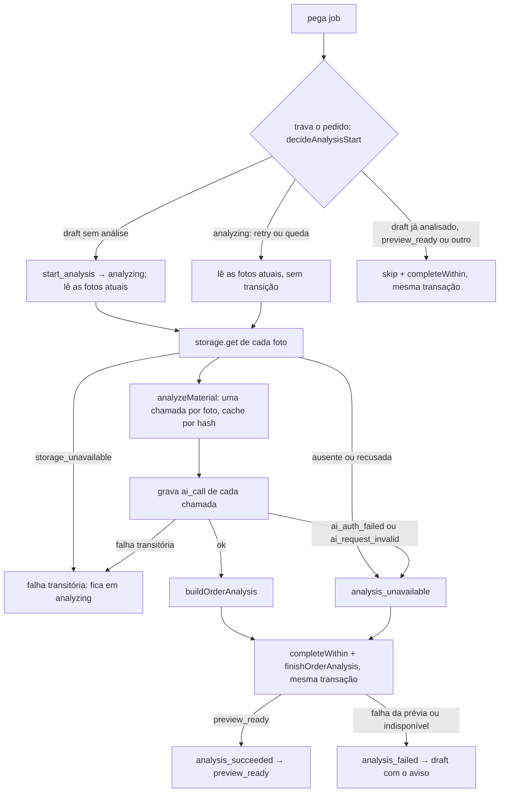
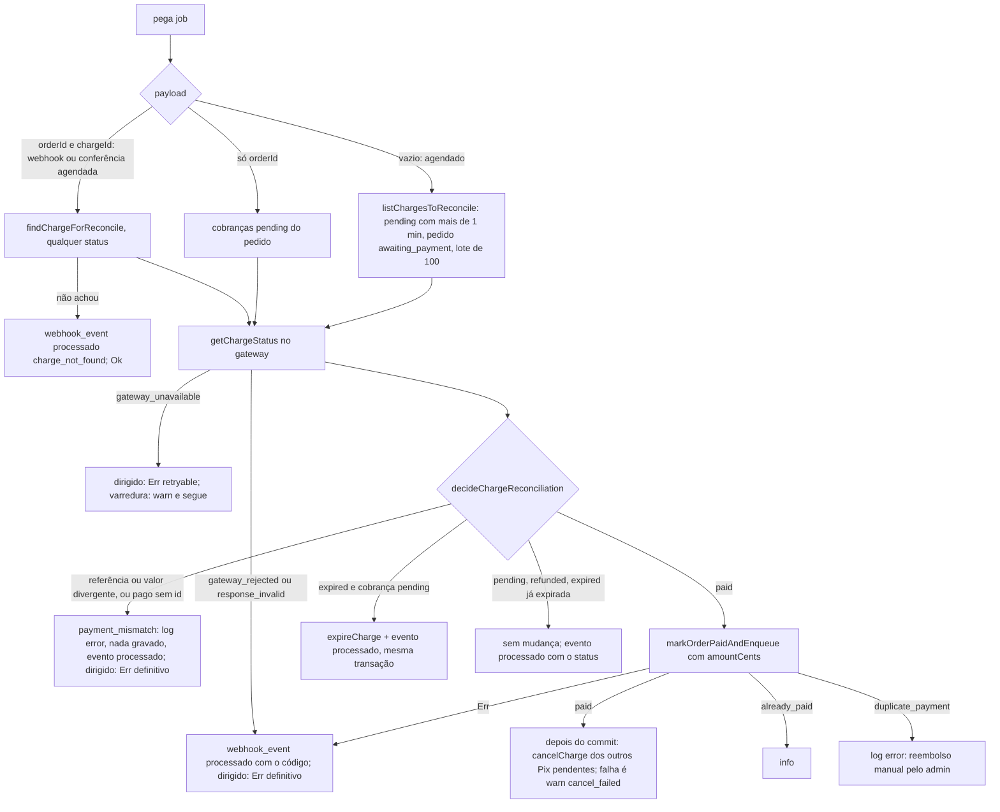
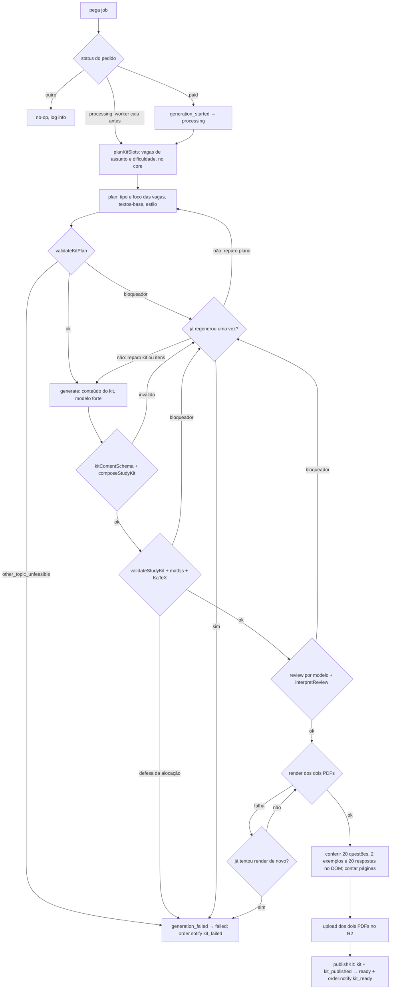

# Jobs e fila (`apps/worker`)

**Versão:** 1.9 · **Data:** 2026-10-22 · **Fonte:** PRD §5, §7.4, §9.1, §9.2; `.claude/rules/worker.md`; `docs/pedagogy/spec-pedagogica.md` (contratos e códigos do pipeline) · **Código:** `jobNameList`, `jobPayloadSchema` e regras de retry em `packages/core/src/jobs/` (F0-04, F0-06); fila própria em `packages/db/src/queue/` (F0-06, ADR-0003 e ADR-0008); loop, agendador e health em `apps/worker/src/` (F0-07)

O worker é um processo Bun que consome a fila no Postgres. Cada job tem um handler em `src/jobs/{nome}.ts`, payload validado por `jobPayloadSchema` ao enfileirar e ao consumir, e é **idempotente**: checa o estado do pedido antes de agir e reexecução não duplica kit, cobrança, e-mail nem mensagem.

## 1. Catálogo

| Job | Payload | Quem enfileira | Transições | Concorrência |
|---|---|---|---|---|
| `order.analyze` | `{ orderId }` | api, `POST /orders` (mesma transação do `draft`) e `PUT /orders/:token/photos` (mesma transação da troca); singleton por `orderId`, então a troca com análise pendente não cria outro | `draft → analyzing → preview_ready` ou `→ draft` com avisos por foto | própria, 2 |
| `order.generate` | `{ orderId }` | `markOrderPaidAndEnqueue` (webhook ou reconciliação); admin `reprocess` | `paid → processing → ready` (via `publishKit`) ou `→ failed` | `GENERATE_CONCURRENCY` (default 2) |
| `order.notify` | `{ orderId, kind }` | `publishKit` (`kit_ready`), `order.generate` ao falhar (`kit_failed`), `confirm` (`order_link`), `whatsapp.inbound` | nenhuma | padrão |
| `charge.reconcile` | `{ orderId?, chargeId?, webhookEventId? }` (`chargeId` e `webhookEventId` só junto com `orderId`) | webhook do Mercado Pago (`{ orderId, chargeId, webhookEventId }`, na transação do `webhook_event`); `markOrderPaidAndEnqueue` (`{ orderId, chargeId }` da cobrança que expirou, com `run_after_datetime` = vencimento + `CHARGE_RECONCILE_AFTER_EXPIRY_MINUTES`); agendador a cada 2 minutos (`{}`) | `awaiting_payment → paid` por `markOrderPaidAndEnqueue`, após consultar o gateway, repassando o `webhookEventId`; cobrança que o gateway deu como vencida → `expired` | 2 |
| `retention.purge` | `{}` | agendador, diário | nenhuma; grava `delete_datetime` | 1 |
| `whatsapp.inbound` | `{ webhookEventId, phone, text ≤ 1000 }` | api, `POST /webhooks/whatsapp` | nenhuma; grava ou remove vínculo | padrão |

O worker agrupa os jobs em raias pela coluna Concorrência (`buildJobLaneList`):
- `order.generate` com `GENERATE_CONCURRENCY` vagas (máximo 8);
- `charge.reconcile` com 2, para o webhook pago não esperar a varredura de 2 min (a varredura é singleton e o pedido é travado em `markOrderPaidAndEnqueue`);
- `retention.purge` com 1;
- `order.analyze` numa raia própria de 2, porque o responsável espera a prévia na tela;
- `order.notify` e `whatsapp.inbound` numa raia de 2.

O pool do worker tem duas conexões por vaga (handler e renovação do lease) mais 2. Cada vaga é um laço sobre `workJob` que dorme 1 s com a fila vazia e 5 s depois de erro de banco, sem morrer. Só sobem raias dos jobs em `handledJobNameList` de `src/jobs/index.ts`, cujo mapa (`buildJobHandlerMap`) recebe banco, `AiProvider`, storage, gateway de pagamento, avaliador matemático, KaTeX, renderizador de PDF e logger no boot; enquanto um job não tem handler, ninguém o reclama nem o agenda.

### Fluxo de `order.analyze` (F2-02; spec pedagógica §3; ADR-0013)

- O início trava o pedido e decide pelo core (`decideAnalysisStart`). Em `draft` sem análise, aplica `start_analysis`. Em `analyzing`, retoma sem transição. Nos outros casos pula. Nos dois primeiros, lê as fotos atuais (por `photo_index`) na mesma transação, então uma troca feita antes do início entra na análise.
- `order.analysis` nula em `draft` ou `analyzing` quer dizer análise pendente. A troca de fotos limpa `analysis`, `material_profile` e as notas de legibilidade, e enfileira uma análise nova (`api.md` §2).
- O cache da extração fica em `extraction_cache` (`data-model.md`). Cada entrada guarda a extração já sanitizada e vale até o fim da retenção da foto que a criou. Numa retentativa ou numa troca, a foto já lida não gera chamada nova.
- Cada chamada de IA vira uma linha de `ai_call` com o `order_id`, gravada logo depois da etapa (`Ok` ou `Err`) e antes de qualquer transição. Uma queda do processo durante as chamadas, que levam segundos, perde o registro delas (`known-issues.md`).
- A transação final chama primeiro `completeWithin` (ADR-0013) e depois `finishOrderAnalysis`. Esta confere se o pedido ainda está em `analyzing` e se as fotos atuais são as analisadas, e só então grava a análise, o `material_profile` (só em `preview_ready`) e o `legibility_score` de cada foto. Os desfechos:
  - lease perdido: desfaz e devolve `lease_lost`;
  - fotos diferentes das analisadas: desfaz e devolve `analysis_photo_set_changed` (transitória), e a retentativa relê as fotos;
  - pedido fora de `analyzing`: desfaz e termina sem efeito, com log `warn`.
- Falha que não volta à fila (`ai_auth_failed`, `ai_request_invalid`, foto ausente ou recusada no storage, pedido sem foto atual) encerra em `{ outcome: "analysis_unavailable" }`, com log `error` e o job `completed` (ADR-0013). Falha transitória (`ai_*` transitório, `extraction_cache_failed`, `storage_unavailable`) segue o retry da fila com o pedido em `analyzing`.
- `onExhausted`: com o pedido em `analyzing`, `analysis_failed` com `analysis_unavailable`, na transação do `failed`; nos outros estados, no-op.
- Log por análise: `orderId`, `stage: "analyze"`, duração, custo, número de chamadas, desfecho, `failCode` e código de erro. Nunca evidência, perfil ou texto da foto.

### Fluxo de `charge.reconcile` (F2-04; PRD §9.1 itens 4 e 5; `payments.md`)

- O payload decide o alvo: com `chargeId`, a cobrança é consultada qualquer que seja o status dela no banco, porque um Pix já `expired` pode ter sido pago (`duplicate_payment`); a varredura só vê `pending`, e a conferência agendada pelo `markOrderPaidAndEnqueue` cobre a cobrança antiga quando o cancelamento falha ou o worker cai antes dele.
- A decisão é do core (`decideChargeReconciliation`): referência ou valor diferente da cobrança é `payment_mismatch`; `paid` sem id na consulta usa o `gateway_payment_id` gravado na criação; `expired` vale mesmo antes do `expire_datetime`, porque o gateway já deu a order como `canceled` ou `failed` e o comprador precisa de "gerar novo Pix". A cobrança vencida pelo relógio fica `pending` até o gateway confirmar: ele expira em lote, 1 a 2 minutos depois, e a varredura vê `action_required` nesse intervalo.
- Desfecho do job: no dirigido, caminhos esperados terminam `completed`; anomalias que não voltam com retentativa (`Err` do `markOrderPaidAndEnqueue`, `payment_mismatch`, `gateway_rejected`, `gateway_response_invalid`) terminam `failed` com o código, para contar no `failedCount` do `/health`; `gateway_unavailable` volta à fila com o `webhook_event` sem `processed_datetime`, e o `onExhausted` grava o código nele. A varredura sempre termina `completed`, com um resumo (`scannedCount`, `paidCount`, `expiredCount`, `pendingCount`, `errorCount`).
- O cancelamento dos outros Pix acontece depois do commit, como melhor esforço: a transação não espera IO externo e a order não cancelada expira sozinha em 30 minutos.
- Log por cobrança: `orderId`, `chargeId`, `webhookEventId`, `stage: "reconcile"`, `outcome`, `gatewayStatus`, `reason` e código; `duplicate_payment` em `error`, `refunded` e `cancel_failed` em `warn`. Nunca `qr_code`, e-mail ou payload.

## 2. Fluxo de `order.generate` (F2-05; PRD §7.4; contratos e códigos na spec pedagógica, ADR-0010)

- Cada chamada de IA grava uma linha em `ai_call`; o pipeline (`generateKit`, F1-07) entrega cada registro ao handler logo depois da chamada (`onAiCall` → `recordAiCallList`), para o custo de uma chamada paga ficar gravado mesmo se algo falhar depois. O custo acumulado do pedido (extração, tentativas anteriores do job e as chamadas da execução; `sumOrderAiCostCents` lê o já gravado) é comparado a `MAX_AI_COST_CENTS_PER_ORDER` antes de cada chamada; igual ou acima, a chamada não acontece e o pedido falha com `ai_cost_exceeded`. Como a conferência é antes da chamada, o custo final pode passar do teto em uma chamada.
- Uma regeneração automática no total (`MAX_REGENERATION_COUNT = 1`), seja por saída inválida, por bloqueador no plano ou na validação ou por bloqueador da revisão; nenhuma delas é transitória nem entra no retry da fila. O código mais forte decide o reparo: plano e kit, kit inteiro ou só os itens marcados (spec pedagógica §10). O "outro" inviável e os códigos de defesa da alocação falham sem regenerar. Saída inválida da revisão ganha uma nova chamada de revisão, que não gasta a regeneração. O render tem uma segunda tentativa própria (timeout do Playwright é comum e barato de repetir).
- O handler tem três ramos pelo status (`decideGenerationStart` do core, aplicado por `startOrderGeneration` com o pedido travado): `paid` → `generation_started`, que também limpa o `fail_reason_code` de um reprocesso anterior, e segue; `processing` (worker caiu no meio ou retentativa) → segue do `plan` sem transição, com o custo já gasto contando no teto; qualquer outro → no-op com log `info`.
- A entrada da geração (`buildGenerationInput` do core) vem dos campos do pedido lidos na mesma transação do início: assuntos confirmados mais o "outro" (por último), perfil do material, dificuldade percebida, observação e os `sourceWarningList` da análise (vazio sem análise). Pedido sem perfil do material ou com assunto fora da taxonomia do ano e disciplina falha com `generation_input_invalid`, sem chamada.
- O handler respeita `signal` (desligamento, teto de execução ou lease perdido): interrompe a etapa em curso e devolve falha transitória (`ai_aborted`), sem publicar nada parcial.
- A regeneração é contada por execução do pipeline: a reexecução do job depois de falha transitória refaz o pedido do zero com a regeneração disponível, e o teto de custo limita o total. O reparo por item que veio da validação termina com revisão completa, porque o kit ainda não foi revisado (spec pedagógica 1.4 §10).
- Falha definitiva (`ai_output_invalid`, `generation_blocked`, `other_topic_unfeasible`, `ai_cost_exceeded`, `render_failed`, `generation_input_invalid`): `failOrderGeneration` numa transação própria (`generation_failed`, `fail_reason_code` e `order.notify` `kit_failed`) e o job termina `failed` com o mesmo código, para contar no `failedCount` do `/health`. Como a falha não é retryable, o `onExhausted` não roda (ADR-0009), então não há transição dupla. Pedido que saiu de `processing` por outro caminho (reembolso) deixa a falha sem efeito, com log `warn`.
- Incidente do provedor de IA (`ai_auth_failed`, `ai_request_invalid`; `aiProviderIncidentCodeList` do core) e `storage_rejected` no upload não são falhas do pedido pago: o handler devolve falha retryable com log `error` `incidente do provedor`, e o pedido fica em `processing` enquanto a fila tenta de novo (3 retentativas em ~10 min). Esgotadas, o `onExhausted` leva a `failed` com o código e o `kit_failed` avisa o responsável; o operador corrige a conta e reprocessa pelo admin. Falhas transitórias (`ai_timeout`, `ai_rate_limited`, `ai_unavailable`, `ai_aborted`, `storage_unavailable`) seguem o retry da fila do mesmo jeito, com log `warn`.
- Publicação: os dois PDFs sobem em `kitStorageKey(orderId, kitId, kind)`, com um `kitId` novo por execução; se um upload falha, o objeto que subiu é apagado antes de voltar à fila. `publishKit` recusado (`InvalidTransitionError`: reembolso durante o processamento) apaga os dois objetos e termina `Ok` com log `warn`, sem kit. Uma falha de upload depois da geração refaz a geração na retentativa (`known-issues.md`).
- Log por execução: `orderId`, `stage: "generate"`, duração, custo da execução, número de chamadas, `repairList` das tentativas, desfecho, código, e na publicação `kitId`, páginas dos dois PDFs e `warningCodeList` do render (`page_count_out_of_range`). Nunca conteúdo do kit, prompt ou resposta.
- `onExhausted` de `order.generate`: com o pedido em `paid` ou `processing`, `failOrderGeneration` com o código do job (`ai_unavailable`, `ai_auth_failed`, `storage_unavailable`, `job_timeout`, `lock_expired`, `unhandled_error`, …) em `fail_reason_code` e `order.notify` `kit_failed`, na transação do `failed`; qualquer outro estado é no-op.

## 3. Idempotência e transações

| Operação | Garantia |
|---|---|
| Enfileirar `order.analyze` | mesma transação do `INSERT` em `order` |
| `markOrderPaidAndEnqueue` | `payment_confirmed` + `charge.paid` + `order.generate` + `webhook_event.processed_datetime` (com o `webhookEventId` do payload de `charge.reconcile`) em uma transação, com pedido e cobrança travados; cobrança já paga com o mesmo pagamento é no-op e unique em `webhook_event (source, external_id)` barra o webhook repetido; detalhes em `data-model.md` §6 |
| `publishKit` | `kit` com as duas keys + `kit_published` + `order.notify` em uma transação; sem as duas keys não roda |
| `charge.reconcile { orderId, chargeId }` | consulta o gateway e chama `markOrderPaidAndEnqueue`, que confere também o valor; pedido já `paid` ou posterior é no-op, salvo se for **outra** cobrança paga do mesmo pedido: abre `support_ticket` `duplicate_payment` e alerta (reembolso manual). Reexecução dá `already_paid`; varredura e job dirigido no mesmo pedido ao mesmo tempo dão um `paid` e um `already_paid` (trava do pedido) |
| `order.notify` | unique `(order_id, kind, channel)` em `notification`: retry de envio atualiza a linha; segundo envio do mesmo evento é `skipped` |
| `whatsapp.inbound` | mensagem é identificada pelo `webhookEventId`; vínculo repetido não muda nada; resposta de ajuda limitada a uma por 24 h por número |
| Payload de job | nunca entra em log, em nível nenhum (o de `whatsapp.inbound` carrega telefone e texto); ao terminar (concluído ou falha definitiva), o payload de `whatsapp.inbound` é reduzido a `name` e `webhookEventId` (`personalDataJobRetainedFieldMap` do core) e a linha fica como registro |

## 4. Retry, falhas e códigos

- Falhas **transitórias** (rede, 5xx, rate limit do provedor): 4 tentativas no total, a primeira e 3 retentativas após 30 s, 2 min e 8 min (`JOB_RETRY_DELAY_SECONDS_LIST` do core), mantendo o estado do pedido. Exceção não tratada no handler conta como transitória (`unhandled_error`).
- **Lease (ADR-0009):**
  - O claim grava `lock_expire_datetime` com 2 min (`JOB_LOCK_TIMEOUT_SECONDS`), e `workJob` renova a cada 30 s (`JOB_LEASE_RENEW_INTERVAL_SECONDS`). Erro de banco na renovação vira log `warn` `lease_renew_failed` (o callback `onLeaseRenewError` só loga e não pode lançar) e tenta de novo no intervalo seguinte.
  - Concluir, falhar, renovar ou liberar exige o par `(job_id, attempt_count)` do claim: worker atrasado recebe `lease_lost` e não fecha a tentativa de outro.
  - `recoverExpiredJobs`, chamado pela manutenção a cada 30 s, devolve a `pending` o job de worker morto, com `last_error_code = lock_expired`. Se o job estiver esgotado, vai para `failed` com compensação (abaixo).
- **Sinal e teto:**
  - O handler recebe `{ signal }`, abortado com `lease_lost` (renovação não achou o lease), `timeout` (passou de `JOB_MAX_RUN_SECONDS`, 15 min; a renovação para) ou `shutdown` (desligamento do worker).
  - Falha transitória depois do teto vira `job_timeout`. Falha transitória no desligamento vira `releaseJob`: volta a `pending` com `worker_shutdown`, sem gastar tentativa; a renovação para antes da liberação.
  - Falha não retryable do handler vence desligamento e teto e vira `failed`.
  - Código de erro que não passa em `outcomeCodeSchema` vira `invalid_error_code`, mantendo o `retryable` do handler.
- Falhas **definitivas**: `generation_failed` com `fail_reason_code` estável e `order.notify` `kit_failed`: `ai_output_invalid` (saída do `plan`, do `generate` ou do reparo fora do schema também na regeneração, ou da revisão também na segunda chamada), `generation_blocked` (bloqueador de plano, validação ou revisão também na regeneração, ou código de defesa da alocação, que não regenera), `ai_cost_exceeded` (teto por pedido), `render_failed` (as duas tentativas de render falharam), `other_topic_unfeasible` (o plano julgou o "outro" inviável só com texto e tabela; não regenera), `generation_input_invalid` (pedido sem perfil do material ou com assunto fora da taxonomia; não deveria acontecer num pedido pago). Pelo esgotamento, `fail_reason_code` também pode ser o código do job: `ai_unavailable`, `ai_timeout`, `ai_rate_limited`, `ai_auth_failed`, `ai_request_invalid`, `storage_unavailable`, `storage_rejected`, `job_timeout`, `lock_expired` ou `unhandled_error`. Os códigos `ai_*` nunca são `fail_reason_code` sem passar pelo esgotamento: os transitórios e os de incidente do operador voltam à fila (§2).
- Job com payload que não passa em `jobPayloadSchema` vai direto para `failed` com `last_error_code = payload_invalid` no claim, sem chamar handler, e o próximo job é entregue; nunca é "corrigido" em runtime. O pedido não muda de estado nem é notificado: é falha da fila, não da geração. O claim avisa o worker (`onPayloadInvalid`), que loga `error` com `payload_invalid`, e o `/health` conta os da janela (`payloadInvalidCount`) para o alerta. Código de erro passa em `outcomeCodeSchema` (minúsculas e `_`, até 64), então não carrega conteúdo.
- **Esgotamento (ADR-0009):**
  - Cada job pode declarar `onExhausted(tx, exhaustedJob)` no mapa de handlers (`JobDefinition = { handle, onExhausted? }`).
  - Ele é chamado na mesma transação do `failed` definitivo de uma falha transitória: retentativas esgotadas, `unhandled_error`, `job_timeout`, `invalid_error_code` ou `lock_expired` esgotado na varredura. Não é chamado em falha não retryable, `payload_invalid` ou `lease_lost`.
  - Contrato: estado de pedido inesperado é no-op; ele só lança em erro de infraestrutura. Se lança, nada é gravado e o job fica `active` até a varredura seguinte, que pula esse job, segue com os outros e loga `error` `job_compensation_failed`.
  - Refeita pela varredura, a compensação recebe `lock_expired` como código.
  - Por job: `order.generate` → `generation_failed` + `kit_failed`; `order.analyze` → `analysis_failed` com `analysis_unavailable` (volta a `draft` com aviso); `order.notify` → notificação `failed`; os demais, só o log.
- **Conclusão dentro da transação do handler (ADR-0013):** o contexto do handler traz `completeWithin(tx)`, que conclui o job na transação do próprio handler e devolve `false` se o lease se perdeu. Quando o handler devolve `Ok` e o `completeJob` de sempre não acha o job ativo, o `workJob` relê a tentativa por `(job_id, attempt_count)`: `completed` dá o desfecho `completed`, e qualquer outro status dá `lease_lost`. Hoje só o `order.analyze` usa.
- Dead letter: job esgotado fica na tabela `job` como `failed`, com `last_error_code` e `finish_datetime`, para o admin ver; alerta por taxa de `failed` e por qualquer `payload_invalid`.
- `workJob` devolve a exceção do handler em `cause` para diagnóstico; ela pode carregar mensagem de provedor ou dado de entrada, então só vai para log em `debug` (invariante 9).

## 5. Agendamento

- `charge.reconcile` sem `orderId`, a cada 2 minutos: cobranças `pending` com mais de 1 minuto (`CHARGE_RECONCILE_MIN_AGE_MINUTES`), de pedidos `awaiting_payment`, em lotes de `CHARGE_RECONCILE_BATCH_SIZE` (100), são consultadas no gateway; pagas passam por `markOrderPaidAndEnqueue`; as que o gateway dá como vencidas viram `expired`. Com `orderId` e `chargeId` (enfileirado pelo webhook ou pelo próprio `markOrderPaidAndEnqueue`), só aquela cobrança, pelo mesmo código (fluxo em §1).
- `retention.purge` uma vez por dia: fotos com `insert_datetime` anterior a 30 dias e kits com `published_datetime` anterior a 12 meses; apaga do storage, grava `delete_datetime`; lote limitado por execução.
- O agendador (`startScheduler`) enfileira na partida e a cada intervalo, com `enqueueSingletonJob` e a chave `scheduled`, só os periódicos que aquele worker consome: o unique parcial em `(name, singleton_key)` mantém um só job pendente ou ativo por nome, com uma réplica ou várias; periódico sem consumidor ficaria pendente e dispararia o alerta de fila parada.
- Manutenção a cada 30 s, no mesmo agendador: `recoverExpiredJobs` com o `onExhausted` do mapa de handlers. Log `warn` quando recupera algo e `error` `job_compensation_failed` por compensação que falhou. Tarefa que falha vira log `error` (`scheduler_task_failed`) e roda de novo no próximo intervalo.

## 6. Observabilidade

- Log por job e por etapa: `orderId`, `jobName`, `stage`, duração, tokens, custo, `outcomeCode`. Nunca imagem, texto extraído, prompt, resposta, observação ou mensagem de WhatsApp. Desde F0-07 o loop loga cada job (`jobId`, `jobName`, `orderId` quando o payload tem, `attemptCount`, `outcome`, `errorCode`, `durationMs`) em `info` (concluído), `warn` (retry, liberado no desligamento ou lease perdido) ou `error` (falha definitiva), nunca o payload.
- `GET /health` do worker (`WORKER_HEALTH_PORT`, 3002): `200 { status: "ok", queue }` com o loop rodando e o banco respondendo, em que `queue` traz `readyCount`, `oldestReadyAgeSeconds` (idade do job pronto mais antigo, para o alerta de fila parada), `activeCount`, `failedCount` e `payloadInvalidCount` das últimas `JOB_FAILED_METRIC_WINDOW_HOURS` (24 h); `503 { status: "unavailable", queue: null }` com o loop parando ou sem banco. Contrato `workerHealthSchema` no core.
- `SIGTERM`/`SIGINT`: para o agendador, aborta o sinal dos handlers e para de reclamar, espera os jobs em curso (o que falhar por causa do sinal volta à fila sem gastar tentativa), fecha o health e o banco e sai com 0; segundo sinal sai com 1. Job morto no meio volta pela recuperação de lock em até ~2,5 min.
- `WHATSAPP_ENABLED=false` ou instância desconectada: `order.notify` pula o canal com `skipped`, e-mail segue.

## Histórico

- **1.0 (2026-10-15):** versão inicial (F0-03). Nomes de jobs e payloads espelham o core de F0-04; detalhes da fila (pg-boss ou própria) ficam para o ADR-0008.
- **1.1 (2026-10-15):** F0-06 e ADR-0008: fila própria; 4 tentativas com os atrasos do core; lock de 15 min com recuperação e lease por `(job_id, attempt_count)`; payload de `whatsapp.inbound` reduzido (não expurgado) ao terminar; agendador por `enqueueSingletonJob`.
- **1.2 (2026-10-16):** F0-07: raias de concorrência, agendador só do que o worker consome, manutenção de locks a cada 60 s, log por job, `payload_invalid` em log `error`, `/health` com métricas da fila e desligamento por sinal.
- **1.3 (2026-10-19):** revisão da F0 e ADR-0009: lease de 2 min renovado a cada 30 s, teto de 15 min por execução, sinal para o handler, liberação sem gastar tentativa no desligamento, código de erro inválido sem travar o job, compensação atômica por `onExhausted`, manutenção a cada 30 s; `charge.reconcile` com `webhookEventId` e 2 vagas; `order.analyze` em raia própria.
- **1.4 (2026-10-19):** F1-02 e ADR-0010: alocação das vagas no core antes do `plan`, `validateKitPlan`, composição do kit, revisão com severidade pelo código, regeneração por reparo (plano, kit ou itens), nova chamada de revisão sem gastar a regeneração e `fail_reason_code` `other_topic_unfeasible`.
- **1.5 (2026-10-21):** F1-07: registro de cada chamada pelo `onAiCall`, teto conferido antes da chamada com o custo já gasto, `ai_aborted` no sinal, regeneração por execução e revisão completa depois do reparo por item vindo da validação.
- **1.6 (2026-10-22):** F2-01: `order.analyze` enfileirado também pela troca de fotos e singleton por `orderId`.
- **1.7 (2026-10-22):** F2-02 e ADR-0013: fluxo do `order.analyze` (início sob trava, retomada, `skip`, cache no banco, `ai_call`, `analysis_unavailable`, `onExhausted`), `completeWithin` no contexto do handler e mapa de handlers montado no boot.
- **1.9 (2026-10-22):** F2-05: handler do `order.generate` (início por `decideGenerationStart` com `fail_reason_code` limpo, entrada por `buildGenerationInput`, custo já gasto por `sumOrderAiCostCents`, incidente do provedor e `storage_rejected` como retry com log `error`, falha definitiva com o job `failed`, publicação com remoção dos PDFs órfãos), `generation_input_invalid` e o mapa de handlers com avaliador, KaTeX e renderizador.
- **1.8 (2026-10-22):** F2-04: fluxo do `charge.reconcile` (alvos por payload, decisão no core, desfecho do job por caminho, cancelamento depois do commit), `chargeId` no payload, conferência agendada da cobrança expirada pelo `markOrderPaidAndEnqueue` e o worker com o `PaymentGateway`.
