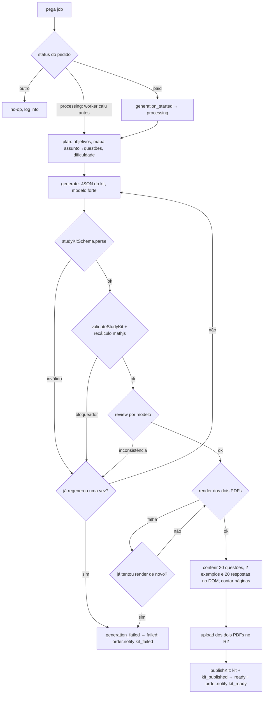

# Jobs e fila (`apps/worker`)

**Versão:** 1.0 · **Data:** 2026-10-15 · **Fonte:** PRD §5, §7.4, §9.1, §9.2; `.claude/rules/worker.md` · **Código:** `jobNameList` e `jobPayloadSchema` em `packages/core/src/jobs/schemas.ts` (F0-04); fila em `packages/db` (F0-06, ADR-0003 e ADR-0008)

O worker é um processo Bun que consome a fila no Postgres. Cada job tem um handler em `src/jobs/{nome}.ts`, payload validado por `jobPayloadSchema` ao enfileirar e ao consumir, e é **idempotente**: checa o estado do pedido antes de agir e reexecução não duplica kit, cobrança, e-mail nem mensagem.

## 1. Catálogo

| Job | Payload | Quem enfileira | Transições | Concorrência |
|---|---|---|---|---|
| `order.analyze` | `{ orderId }` | api, `POST /orders` (mesma transação do `draft`) | `draft → analyzing → preview_ready` ou `→ draft` com avisos por foto | padrão |
| `order.generate` | `{ orderId }` | `markOrderPaidAndEnqueue` (webhook ou reconciliação); admin `reprocess` | `paid → processing → ready` (via `publishKit`) ou `→ failed` | `GENERATE_CONCURRENCY` (default 2) |
| `order.notify` | `{ orderId, kind }` | `publishKit` (`kit_ready`), `order.generate` ao falhar (`kit_failed`), `confirm` (`order_link`), `whatsapp.inbound` | nenhuma | padrão |
| `charge.reconcile` | `{ orderId? }` | webhook do Mercado Pago (com `orderId`, na transação do `webhook_event`); agendador a cada 2 minutos (sem `orderId`) | `awaiting_payment → paid` por `markOrderPaidAndEnqueue`, após consultar o gateway; cobrança vencida → `expired` | 1 |
| `retention.purge` | `{}` | agendador, diário | nenhuma; grava `delete_datetime` | 1 |
| `whatsapp.inbound` | `{ webhookEventId, phone, text ≤ 1000 }` | api, `POST /webhooks/whatsapp` | nenhuma; grava ou remove vínculo | padrão |

## 2. Fluxo de `order.generate` (PRD §7.4)

- Cada chamada de IA grava uma linha em `ai_call`; o custo acumulado do pedido é comparado a `MAX_AI_COST_CENTS_PER_ORDER` antes de cada chamada; exceder é falha segura.
- Uma regeneração automática no total (`MAX_REGENERATION_COUNT = 1`), seja por saída inválida no `parse`, por bloqueador na validação ou por inconsistência na revisão; nenhuma delas é transitória nem entra no retry da fila. O render tem uma segunda tentativa própria (timeout do Playwright é comum e barato de repetir).
- O handler tem três ramos pelo status: `paid` → `generation_started` e segue; `processing` (worker caiu no meio) → segue do `plan` sem transição, com o custo já gasto contando no teto; qualquer outro → no-op com log `info`.

## 3. Idempotência e transações

| Operação | Garantia |
|---|---|
| Enfileirar `order.analyze` | mesma transação do `INSERT` em `order` |
| `markOrderPaidAndEnqueue` | `payment_confirmed` + `charge.paid` + `order.generate` + `webhook_event.processed_datetime` em uma transação; unique em `charge.gateway_payment_id` e em `webhook_event (source, external_id)` fazem a repetição ser no-op |
| `publishKit` | `kit` com as duas keys + `kit_published` + `order.notify` em uma transação; sem as duas keys não roda |
| `charge.reconcile { orderId }` | consulta o gateway e chama `markOrderPaidAndEnqueue`; pedido já `paid` ou posterior é no-op, salvo se for **outra** cobrança paga do mesmo pedido: abre `support_ticket` `duplicate_payment` e alerta (reembolso manual) |
| `order.notify` | unique `(order_id, kind, channel)` em `notification`: retry de envio atualiza a linha; segundo envio do mesmo evento é `skipped` |
| `whatsapp.inbound` | mensagem é identificada pelo `webhookEventId`; vínculo repetido não muda nada; resposta de ajuda limitada a uma por 24 h por número |
| Payload de job | nunca entra em log, em nível nenhum (o de `whatsapp.inbound` carrega telefone e texto); linhas concluídas de `whatsapp.inbound` são expurgadas na conclusão |

## 4. Retry, falhas e códigos

- Falhas **transitórias** (rede, 5xx, rate limit do provedor): retry com backoff exponencial pela fila (por exemplo 30 s, 2 min, 8 min; 3 tentativas), mantendo o estado do pedido.
- Falhas **definitivas**: `generation_failed` com `fail_reason_code` estável e `order.notify` `kit_failed`: `ai_output_invalid` (saída não passou em `studyKitSchema` também na regeneração), `generation_blocked` (bloqueador na validação ou inconsistência na revisão também na regeneração), `ai_cost_exceeded` (teto por pedido), `render_failed` (as duas tentativas de render falharam), `payload_invalid` (payload do job não passou no schema).
- Job com payload que não passa em `jobPayloadSchema` vai direto para falha com `outcome_code = payload_invalid`; nunca é "corrigido" em runtime.
- Dead letter: job esgotado fica na fila marcado como `failed` para o admin ver; alerta por taxa de `failed`.

## 5. Agendamento

- `charge.reconcile` sem `orderId`, a cada 2 minutos: cobranças `pending` com mais de 1 minuto são consultadas no gateway; pagas passam por `markOrderPaidAndEnqueue`; vencidas (`expire_datetime` passado e gateway confirma) viram `expired`. Com `orderId` (enfileirado pelo webhook), só aquele pedido, imediatamente, pelo mesmo código.
- `retention.purge` uma vez por dia: fotos com `insert_datetime` anterior a 30 dias e kits com `published_datetime` anterior a 12 meses; apaga do storage, grava `delete_datetime`; lote limitado por execução.
- Com uma réplica do worker, o agendador é um `setInterval` no processo; com mais de uma, lock por nome do job na própria fila (decisão em F0-06).

## 6. Observabilidade

- Log por job e por etapa: `orderId`, `jobName`, `stage`, duração, tokens, custo, `outcomeCode`. Nunca imagem, texto extraído, prompt, resposta, observação ou mensagem de WhatsApp.
- `/health` do worker responde 200 enquanto o loop está vivo; métrica de idade do job mais antigo pendente alimenta o alerta de fila parada.
- `WHATSAPP_ENABLED=false` ou instância desconectada: `order.notify` pula o canal com `skipped`, e-mail segue.

## Histórico

- **1.0 (2026-10-15):** versão inicial (F0-03). Nomes de jobs e payloads espelham o core de F0-04; detalhes da fila (pg-boss ou própria) ficam para o ADR-0008.
