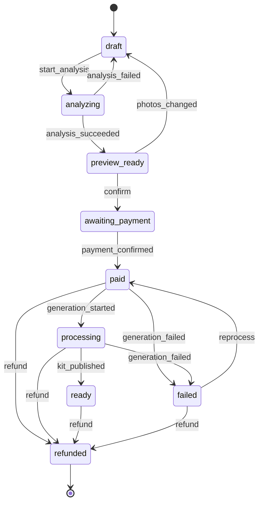

# Máquina de estados do pedido

**Versão:** 1.3 · **Data:** 2026-10-22 · **Fonte:** PRD §5; design doc §6.8 · **Código:** `packages/core/src/order/state-machine.ts` (F0-04) · **Regras:** `.claude/rules/core.md`

O estado do pedido só muda pela função `transitionOrder(status, event)` do core, chamada por um service **dentro de uma transação** (invariante 1). A máquina é dado (`orderTransitionList`), não código: toda transição válida está na tabela abaixo e toda combinação fora dela devolve `InvalidTransitionError` sem lançar.

## 1. Diagrama

## 2. Transições

| De | Evento | Para | Quem dispara | Quando |
|---|---|---|---|---|
| `draft` | `start_analysis` | `analyzing` | worker, `order.analyze` | ao pegar o job, com `order.analysis` nula (análise pendente); `draft` com análise já gravada não reinicia (`decideAnalysisStart`) |
| `analyzing` | `analysis_succeeded` | `preview_ready` | worker, `order.analyze` | extração devolveu ao menos um candidato e material suficiente; o teto de 3 assuntos é da confirmação; grava `order.analysis` e `material_profile` |
| `analyzing` | `analysis_failed` | `draft` | worker, `order.analyze` | fotos insuficientes ou ilegíveis, só assunto não atendido ou nenhum assunto (avisos por foto e `failCode` em `order.analysis`); ou análise indisponível (`analysis_unavailable`: falha definitiva do provedor ou do storage, ou retentativas esgotadas pelo `onExhausted`) |
| `preview_ready` | `confirm` | `awaiting_payment` | api, `POST /orders/:token/confirm` | assuntos, e-mail e aceite válidos; a cobrança é criada no gateway antes (idempotente por `chargeId`) e gravada na mesma transação da transição |
| `preview_ready` | `photos_changed` | `draft` | api, rota de fotos (F2-01) | o responsável troca uma foto pela ação "Trocar foto" (design doc §6.3, PRD §5 "foto ruim: nova foto antes do Pix"); os assuntos confirmados são descartados, `order.analysis` e `material_profile` são limpos e a análise recomeça por `start_analysis` (a troca em `draft` também limpa a análise, sem transição) |
| `awaiting_payment` | `payment_confirmed` | `paid` | worker, `charge.reconcile` (disparado pelo webhook com `orderId` ou pelo agendador) | **após consultar o gateway**; `markOrderPaidAndEnqueue` enfileira `order.generate` e expira as demais cobranças `pending` do pedido na mesma transação |
| `paid` | `generation_started` | `processing` | worker, `order.generate` | ao pegar o job |
| `paid` | `generation_failed` | `failed` | worker, `onExhausted` de `order.generate` (ADR-0009) | o job esgotou as tentativas antes de começar a gerar; `fail_reason_code` do job e `order.notify` `kit_failed` na mesma transação |
| `processing` | `kit_published` | `ready` | worker, `publishKit` | os dois PDFs no storage e validações críticas verdes |
| `processing` | `generation_failed` | `failed` | worker, `order.generate` ou o `onExhausted` dele | bloqueador persistente após uma regeneração, custo excedido, erro não transitório ou tentativas esgotadas; `fail_reason_code` gravado |
| `failed` | `reprocess` | `paid` | admin | reenfileira `order.generate`; o job sempre parte de `paid` |
| `paid`, `processing`, `ready`, `failed` | `refund` | `refunded` | admin, com motivo | após reembolso no gateway; `refund_id` gravado na cobrança |

Estados terminais: só `refunded`. Estados em que o WhatsApp pode ser vinculado (`isWhatsappLinkableOrderStatus`, PRD §9.2): `paid`, `processing`, `ready`.

## 3. Sub-estado `charge_expired`

Não é um status do pedido. Com o pedido em `awaiting_payment`, o sub-estado deriva da cobrança ativa: `deriveAwaitingPaymentSubstate(charge, now)` devolve `charge_expired` quando a cobrança está `expired` ou é `pending` com `expire_datetime <= now`. "Gerar novo Pix" (`POST /orders/:token/charges`) cria outra cobrança no mesmo pedido; o status continua `awaiting_payment`. Um pedido tem no máximo uma cobrança ativa, garantida pela trava do pedido na inserção (F2-03). A cobrança vencida continua `pending` no banco até a reconciliação consultar o gateway e marcá-la `expired` (F2-04): marcá-la sem consultar tiraria da varredura um Pix pago no último segundo com o webhook perdido.

## 4. Casos obrigatórios (PRD §5)

| Situação | Comportamento |
|---|---|
| Webhook repetido | `webhook_event` é unique por (`source`, `external_id`): segundo recebimento responde 200 sem efeito |
| Pagamento confirmado para pedido já `paid` ou posterior | no-op na máquina (`transitionOrder` recusaria de qualquer forma); se for **outra cobrança** do mesmo pedido, o responsável pagou duas vezes: `markOrderPaidAndEnqueue` abre `support_ticket` `duplicate_payment` e dispara alerta para reembolso manual pelo admin |
| Pix pago depois da cobrança expirar | ainda vale: `payment_confirmed` segue e as demais cobranças `pending` do pedido viram `expired` (canceladas no gateway quando a API permitir), para um segundo Pix já gerado não ser pago também |
| Webhook atrasado ou perdido | `charge.reconcile` consulta o gateway a cada 2 minutos para cobranças `awaiting_payment` com mais de 1 minuto |
| Falha de geração | uma regeneração automática dentro do mesmo job; persistindo, `generation_failed` e aviso ao responsável (`kit_failed`) |
| Falha transitória até esgotar a fila | o `onExhausted` de `order.generate` aplica `generation_failed` (de `paid` ou `processing`) e enfileira `kit_failed` na transação do `failed` do job; o admin pode reprocessar a partir de `failed` |
| Reembolso durante `processing` | `refund` leva a `refunded`; quando o job tentar `kit_published`, a máquina recusa e o kit não é publicado |
| Arquivo final indisponível | `publishKit` só roda com as duas keys; sem elas o pedido não chega a `ready` |
| Análise reexecutada | `analyzing` retoma sem transição, com o cache da extração; `preview_ready` e `draft` já analisado são pulados sem chamar a IA |
| Troca de foto logo depois do fim da análise | o job é concluído na mesma transação de `analysis_succeeded` ou `analysis_failed` (`completeWithin`, ADR-0013), então a troca sempre enfileira a análise nova |

## 5. Estado → rota (design doc §6.8)

O web decide a rota canônica a partir do status devolvido por `GET /orders/:token` e redireciona ao abrir rota incompatível. A tabela completa está no design doc §6.8; `failed` e `refunded` vão para `/pedido/:token/erro`. Token inexistente devolve 404 neutro e a página "Pedido não encontrado".

## 6. Testes

`packages/core/src/__tests__/order/state-machine.test.ts`: a tabela é comparada com a lista literal da jornada do PRD; cada transição válida é testada; todas as 84 combinações status × evento fora da tabela devolvem `InvalidTransitionError` com `from` e `event`; `payment_confirmed` só é aceito de `awaiting_payment`. Services que persistem transições têm teste de integração com Postgres real (F0-05 em diante).

## Histórico

- **1.3 (2026-10-22):** F2-03: a renovação do Pix não marca a vencida `expired`; a trava do pedido garante uma cobrança ativa. Sem transição nova.
- **1.2 (2026-10-22):** F2-02: análise pendente (`order.analysis` nula), `analysis_unavailable`, reexecução do `order.analyze` e conclusão do job na transação da transição (ADR-0013). Sem transição nova.
- **1.1 (2026-10-19):** `preview_ready → draft` por `photos_changed` ("Trocar foto") e `paid → failed` por `generation_failed` (esgotamento antes de gerar), decididos pelo humano na revisão da F0 (`specs/cross/revisao-f0/`); `confirmedOrderStatusList` (alcançáveis de `awaiting_payment`) exige ao menos um assunto.
- **1.0 (2026-10-15):** versão inicial (F0-03), espelhando o código de F0-04.
