# Gizito — Roadmap de Implementação v1.5

**Status:** em execução  
**Fase atual:** F1 — Prova técnica e pedagógica  
**Data:** 14/10/2026  
**Estado atualizado em:** 21/10/2026  
**Relação com o PRD:** detalha a seção 11 do `product-doc-v1.md` em fases, features e critérios de passagem  
**Como usar:** cada feature vira uma spec em `specs/{modulo}/{slug}/` executada pelo fluxo `gizito-spec-driven`; as fases só avançam quando o critério de saída é atendido  
**Como marcar:** `[x]` concluída, com data e commit ou spec ao lado · `[ ]` com **em andamento** no título quando iniciada, com o sub-item "Feito até agora" · `[ ]` sem marca é pendente. Ao concluir uma feature, marcar o item e trocar "Feito até agora" por "Concluída em". Ao fechar uma fase, marcar o gate, atualizar a coluna Estado da seção 2, o bloco "Estado atual" abaixo e a tabela de estado de `docs/README.md`

## Estado atual

Já existe no repositório, antes de qualquer feature do roadmap:

- [x] PRD v1 (`docs/product/product-doc-v1.md`) e design doc v1 (`docs/design/design-doc-v1.md`) — 14/10/2026
- [x] Este roadmap — 14/10/2026
- [x] Harness de agentes: `CLAUDE.md`, `.claude/rules`, skills, agentes e fluxo `gizito-spec-driven` — ADR-0001, 14/10/2026
- [x] Esqueleto de docs: `docs/README.md`, `docs/lessons.md`, `docs/engineering/known-issues.md`, templates de ADR, progress e spec — 14/10/2026
- [x] `git init`, `.gitignore` e primeiro commit (`ada7324`) — 14/10/2026

Resumo por fase:

| Fase | Features | Concluídas | Em andamento | Pendentes |
|---|---|---|---|---|
| F0 Fundação | 7 | 7 | 0 | 0 |
| F1 Prova técnica e pedagógica | 11 | 6 | 0 | 5 |
| F2 Fluxo comercial | 14 | 0 | 0 | 14 |
| F3 Piloto pago | 5 atividades | 0 | 0 | 5 |
| F4 Pós-validação | 8 itens por gatilho | 0 | 0 | 8 |

## 1. Análise

### 1.1 Caminho crítico

O risco do produto está no pipeline pedagógico, não no fluxo comercial. Cobrar por Pix, entregar PDF e avisar no WhatsApp é engenharia conhecida; extrair assuntos de um caderno manuscrito, gerar 20 questões corretas e adequadas ao ano, e barrar automaticamente o que estiver errado é o que decide se o Gizito existe. Por isso a ordem é: fundação mínima → prova pedagógica completa com regressão → só então fluxo comercial → piloto.

Caminho crítico (cada passo bloqueia o seguinte):

```mermaid
flowchart LR
  A[F0 core + db + fila] --> B[F1 taxonomia v1]
  B --> C[F1 schemas e validações do kit]
  C --> D[F1 pipeline extração e geração]
  D --> E[F1 render dos dois PDFs]
  E --> F[F1 regressão com 35 casos]
  F --> G[F2 pedidos, Pix e jobs]
  G --> H[F2 web, WhatsApp, admin]
  H --> I[F2 deploy e aceite do MVP]
  I --> J[F3 piloto pago]
```

### 1.2 Riscos que ordenam o roadmap

| Risco | Onde se resolve | Mitigação |
|---|---|---|
| Extração ruim em caderno manuscrito derruba a prévia e a conversão | F1-06, F1-10 | 30 imagens manuscritas geradas por IA na regressão, sem foto real (risco assumido, PRD 7.6); `legibility_score` por foto; recusa antes do Pix; extração em caderno real medida em produção |
| Recálculo matemático cobre aritmética, não interpretação do problema | F1-03, F1-07 | o modelo devolve a expressão de cálculo e a resposta; mathjs confere a expressão; a revisão por modelo confere a interpretação; ambos são bloqueadores |
| pg-boss pode não rodar bem no Bun | F0-06 | spike de 1 dia antes de qualquer job; alternativa pronta com `FOR UPDATE SKIP LOCKED` |
| Playwright com Chromium no container do worker | F1-08, F2-13 | imagem própria do worker testada em F1; render em F1 já roda no container |
| Conta nova do Mercado Pago passa por análise ou retenção | F2-03 | criar a conta em F0 para envelhecer; sandbox em F2; Asaas atrás da mesma interface |
| Banimento do número de WhatsApp (Baileys) | F2-10 | chip dedicado aquecido desde F1; somente resposta; `WHATSAPP_ENABLED` |
| Custo da prévia gratuita sob abuso | F2-01 | rate limit por IP e dispositivo; modelo barato; cache por hash; custo-alvo medido em F1 |
| Escopo cresce no web (mascote, animações) | F2-08, F2-09 | só poses estáticas e componentes P0; polimento é F4 |
| Uma pessoa só: trabalho sequencial | todas | agentes em paralelo onde os arquivos são disjuntos; tarefas humanas com antecedência (1.4) |

### 1.3 O que anda em paralelo

- Em F1, enquanto o pipeline é construído, você coleta os materiais dos casos, combina a revisão com um professor, cria a conta do Mercado Pago, registra o domínio, compra o chip e gera as seis poses do mascote.
- Em F2, o web (F2-08, F2-09) pode ser implementado contra a API com adaptadores falsos ao mesmo tempo que pagamentos e jobs; são módulos disjuntos.
- WhatsApp (F2-10) e admin (F2-11) são independentes entre si e dependem só do job de geração.

### 1.4 Pendências do humano, com antecedência

- [x] `git init` e primeiro commit — necessário em F0-01 — feito em 14/10/2026
- [x] Chave do provedor de IA — necessário em F1-05 — provedor decidido em 20/10/2026 (Anthropic: Haiku 5.5 na extração, Sonnet 5.5 na geração e revisão, PRD 1.4 §12.1); chave no `.env` usada pelos testes contra a API em 20/10/2026 e limite de gasto na conta confirmado em 21/10/2026
- [x] Materiais dos casos da regressão — necessário em F1-10 — 30 imagens de caderno geradas por IA em `docs/materiais-fotograficos/` (21/10/2026), fora do git, de 2 a 5 por ano × disciplina. Os 40 materiais fotografados de antes viraram 35 casos: as 30 imagens e 5 variações delas que a F1-10 gera (1 ilegível e 4 com dado pessoal inventado). Fotos reais não serão coletadas antes do lançamento; a extração em caderno real é medida em produção. Decisão do humano em 21/10/2026, com o risco assumido (PRD 1.5 §7.6, spec pedagógica 1.3 §13.1 e §15.8)
- [x] Professor(a) para revisar amostra — necessário em F1-11 — combinar em F1; a taxonomia da F1-01 (`docs/pedagogy/taxonomia.md`) já foi revisada e aprovada pelo professor em 19/10/2026; revisão da amostra combinada, confirmado em 21/10/2026
- [ ] Conta Mercado Pago pessoa física, chave Pix, aplicação e credenciais de teste — necessário em F2-03 — começar em F0, para a conta envelhecer; conta criada (confirmado em 21/10/2026), faltam as credenciais de teste
- [ ] Domínio e consulta de anterioridade no INPI — necessário em F2-07 e antes de divulgar — começar em F0; `gizito.com.br` disponível para registro em 21/10/2026, ainda não registrado; consulta ao INPI sem registro aqui
- [ ] Bucket R2 — necessário em F2-01 — começar no início de F2
- [ ] Resend com domínio autenticado (SPF, DKIM, DMARC) — necessário em F2-07 — começar no início de F2; DNS leva horas a dias
- [ ] VPS — necessário em F2-13 — começar no meio de F2
- [ ] Chip e aparelho dedicados ao WhatsApp, número aquecido com uso normal — necessário em F2-10 — comprar em F1; aquecer 1 a 2 semanas; ainda não comprados em 21/10/2026
- [x] Seis poses do mascote geradas a partir de `docs/gizito-image/mascote-sem-fundo.png` — necessário em F2-08 — fazer em F1, em paralelo. Oito imagens em `docs/gizito-image/mascotes-poses/` (21/10/2026), com fundo transparente, conferidas contra o design doc 3.1 e 3.4. Mapa dos estados do 3.2:
  - `hello`: 01, braços abertos;
  - `success`: 02, joinha, com a 03 (comemorando) como alternativa;
  - `point`: 05, dedo para cima;
  - `thinking`: 06, mão no queixo;
  - `idle`: 07, postura neutra;
  - `concern`: 08, acolhedora.

  A 04 (carregando livros) serve para ilustração de seção
- [ ] Textos legais (termos com arrependimento, privacidade) — necessário em F2-12 — redigir em F2

## 2. Visão geral

| Fase | Objetivo | Saída principal | Critério de saída | Esforço estimado | Estado |
|---|---|---|---|---|---|
| F0 Fundação | Repositório pronto para construir | monorepo, infra local, core e db com máquina de estados e fila, docs técnicos | lint, typecheck e testes verdes; fila idempotente testada; ADRs escritos | 1 a 2 semanas | concluída |
| F1 Prova técnica e pedagógica | Do caderno aos dois PDFs, com validação, sem web nem Pix | taxonomia v1, pipeline completo por CLI, regressão com 35 casos, 2 kits de amostra | zero bloqueador crítico inesperado na regressão; amostra aprovada por professor; custo e tempo medidos | 3 a 5 semanas | em andamento |
| F2 Fluxo comercial | Compra ponta a ponta em produção | API, worker, web, WhatsApp, admin, legal, deploy | checklist da seção 10 do PRD completa; compra real feita por você e entregue num celular real | 4 a 6 semanas | pendente |
| F3 Piloto pago | Validar H1 a H4 com dinheiro real | 10 a 20 responsáveis, auditoria semanal, métricas | memo de decisão com evidência das hipóteses | 3 a 4 semanas de calendário | pendente |
| F4 Pós-validação | Crescer só com gatilho | 8º e 9º ano, preço, WhatsApp oficial, novas matérias | por gatilho, item a item | aberto | pendente |

As estimativas são para uma pessoa com agentes, sem outro trabalho em paralelo, e servem para ordenar, não para prometer. O gate entre fases é o critério de saída, não a data.

## 3. Fase 0 — Fundação

**Estado:** concluída · 7 de 7 concluídas · gate fechado em 16/10/2026

- [x] **F0-01 `repo-e-monorepo`** — infra · M · depende: — · 14/10/2026 · `8d2509c` · `specs/infra/repo-e-monorepo/`
  - Entrega: `git init`, Bun Workspaces, Turborepo, Biome, tsconfig base, layout `apps/{web,api,worker}` e `packages/{core,db,integrations}`, `.env.example`, scripts raiz, CI de lint/typecheck/test
  - Pronto quando: `bun run lint`, `typecheck` e `test` verdes no repo vazio; CI passando no primeiro push
  - Concluída em: 14/10/2026. Bun 1.3.11, Turborepo 2, Biome 2, TypeScript 7, packages exportando fonte TS sem build, testes de resolução de imports por workspace, CI em `.github/workflows/ci.yml` (primeiro run acontece no primeiro push, que é do humano). `db:generate`/`db:migrate` entram em F0-05 e `test:pedagogy` em F1-10 porque o Turborepo falha em task sem implementação
- [x] **F0-02 `infra-local-compose`** — infra · P · depende: F0-01 · 15/10/2026 · `dcb3319` · `specs/infra/infra-local-compose/`
  - Entrega: `docker-compose.yml` com Postgres 16 (bancos `gizito` e `evolution`), Redis 7 e Evolution API fixada na linha 2.x; healthchecks; portas só locais
  - Pronto quando: `docker compose up -d` saudável; Evolution responde na porta interna com a API key
  - Concluída em: 15/10/2026. `evoapicloud/evolution-api:v2.3.7` (última estável da linha 2.x), banco `evolution` criado por script em `infra/postgres/initdb/`, healthchecks nos três serviços, portas só em `127.0.0.1`, Evolution sem gravar mensagens, contatos nem chats (LGPD), CI valida `docker compose config`. Primeira subida em ~41 s (migrations da Evolution), reinício em ~11 s
- [x] **F0-03 `design-tecnico-e-adrs`** — docs · M · depende: — · 16/10/2026 · `d4626a7` · `specs/docs/design-tecnico-e-adrs/`
  - Entrega: `docs/engineering/architecture.md`, `data-model.md`, `state-machine.md`, `api.md`, `jobs.md`; ADRs 0002 a 0007 (monorepo Bun, fila no Postgres, Mercado Pago, Evolution API, TanStack Start + Elysia, dois PDFs); o 0001 já é o harness
  - Pronto quando: revisados por você; índice de `docs/README.md` atualizado
  - Concluída em: 16/10/2026. Os cinco docs e os ADRs 0002 a 0007 escritos e indexados em `docs/README.md` em 15/10, com revisão neutra aprovada; revisados pelo humano em 16/10. `data-model.md`, `jobs.md` e `api.md` já receberam as versões de F0-05 a F0-07
- [x] **F0-04 `core-fundacao`** — core · M · depende: F0-01 · 15/10/2026 · `74c3c61` · `specs/core/core-fundacao/`
  - Entrega: constantes de negócio, enums com `List`, máquina de estados do pedido como dado, schemas de pedido, cobrança e payload de job, interfaces `PaymentGateway`, `NotificationChannel`, `AiProvider`, `ObjectStorage`, `MathEvaluator`
  - Pronto quando: toda transição válida e inválida testada; nenhum IO no pacote
  - Concluída em: 15/10/2026. 13 transições do PRD §5 como dado, `transitionOrder` com `Result` e teste exaustivo status × evento (90 combinações); schemas de pedido, foto, cobrança e dos 6 payloads de job; regras puras de cobrança (30 min) e retenção (30 dias / 12 meses) com relógio por parâmetro; `expectedAnswerSchema`; keys de storage; cinco interfaces com teste de contrato; teste de pureza (só `zod` e `#src`, sem env/relógio/IO) e cobertura mínima de 70% no `bunfig.toml`. 184 testes
- [x] **F0-05 `db-fundacao`** — db · M · depende: F0-02, F0-04 · 15/10/2026 · `5f2b6a3` · `specs/db/db-fundacao/`
  - Entrega: schema Drizzle das tabelas do MVP (`order`, `order_photo`, `charge`, `kit`, `ai_call`, `webhook_event`, `notification`, `support_ticket`), migration 0001, conexão, `test-helpers` com Postgres em docker
  - Pronto quando: migration aplica do zero; teste de integração sobe banco e insere um pedido
  - Concluída em: 15/10/2026. drizzle-orm 0.45 com driver `bun-sql` (Bun.SQL nativo, sem `pg`); 13 `pgEnum` vindos das listas do core; índices do data-model (unique parcial em `gateway_payment_id`), checks de domínio, FKs `restrict` e trigger de `update_datetime` na migration `0000_fundacao` (numeração nativa do drizzle-kit); `db:migrate` por script próprio porque o drizzle-kit não detecta o driver do Bun; `createTestDatabase()` cria um banco `gizito_test_*` por chamada; 88 testes unit e 32 de integração; CI roda a integração com o Postgres do compose. Corrigiu de passagem o `publicTokenSchema` do core (`66f1217`). Sem `coverageThreshold` no `db` por limitação do Bun (known-issues)
- [x] **F0-06 `fila-postgres`** — db · P · depende: F0-05 · 15/10/2026 · `db5e365` · `specs/db/fila-postgres/`
  - Entrega: spike pg-boss no Bun contra fila própria com `SKIP LOCKED`; decisão em ADR 0008; `enqueue` e `work` com payload validado por Zod; `markOrderPaidAndEnqueue` e `publishKit` como transações
  - Pronto quando: job enfileirado e consumido na mesma transação do estado; reexecução idempotente testada
  - Concluída em: 15/10/2026. Spike: pg-boss 12.38 roda no Bun 1.3.11 (inclusive sobre Bun.SQL e em transação do Drizzle), mas o ADR-0008 escolhe a fila própria por encaixe nas convenções e no migrator. Tabela `job` (migration `0001_fila`), `enqueueJob`/`enqueueSingletonJob`, claim em uma instrução com `FOR UPDATE SKIP LOCKED`, 4 tentativas (30 s, 2 min, 8 min), lock de 15 min com `recoverExpiredJobs`, `workJob`, payload revalidado no consumo e payload de `whatsapp.inbound` reduzido ao terminar. `markOrderPaidAndEnqueue` com a decisão pura `decidePaymentConfirmation` no core (pago, no-op, duplicado com ticket, divergência) e `publishKit` com as duas keys validadas no core. Corrigiu de passagem o `jsonb` de F0-05, que o Drizzle gravava como string no `bun-sql` (`62facd6`). Core 212 testes; db 98 unit e 95 de integração
- [x] **F0-07 `esqueleto-das-apps`** — api, worker, web · M · depende: F0-05 · 16/10/2026 · `c579f79` · `specs/cross/esqueleto-das-apps/`
  - Entrega: api com `/health` e config Zod fail-fast; worker com loop da fila e health; web TanStack Start com página vazia usando os tokens do design doc
  - Pronto quando: `bun run dev` sobe os três; health responde
  - Concluída em: 16/10/2026. Size M em vez de P (as três apps mais core, db e integrations). Api Elysia 1.4 com Zod 4 nas respostas, `/health` 200/503 pelo banco, erros `{ error, code }` (`not_found`, `validation_error`, `internal_error`), CORS só para a origem de `WEB_PUBLIC_URL`, log Pino por padrão de rota. Worker com raias de concorrência sobre `workJob` (só nomes com handler; o mapa de produção começa vazio), agendador singleton dos periódicos, manutenção de locks a cada 60 s, `/health` com métricas da fila e `payload_invalid` em log `error`. Config das duas apps estende o schema compartilhado do core, sai com 1 nomeando o campo e recusa `PAYMENT_GATEWAY=fake` e log `debug` em produção; logger mascara e-mail, telefone e token no `err`; desligamento limpo por `SIGTERM`. Web TanStack Start 1.169 + Vite 8 + Tailwind 4.3 com os 12 tokens de cor (teste confere contra o design doc) e 404 em pt-BR. `bun run dev` sobe as três com o `.env` da raiz

- [x] **Gate F0 → F1:** lint, typecheck e testes verdes; fila idempotente testada; ADRs escritos; tabela de estado de `docs/README.md` atualizada — 16/10/2026. Suíte local verde (unit, integração com Postgres e build); o primeiro run da CI acontece no primeiro push, que ainda não houve

## 4. Fase 1 — Prova técnica e pedagógica

**Estado:** em andamento · 6 de 11 concluídas

- [x] **F1-01 `taxonomia-v1`** — pedagogy, core · L · depende: F0-04 · 19/10/2026 · `92cbec0` · `specs/pedagogy/taxonomia-v1/`
  - Entrega: 8 arquivos (4º a 7º × Matemática e Português) com 15 a 30 assuntos cada: id estável, nome, descrição, habilidades BNCC, pré-requisitos, validações aplicáveis; `taxonomyVersion`
  - Pronto quando: testes de integridade (ids únicos, pré-requisitos existentes); amostra revisada pelo professor
  - Concluída em: 19/10/2026. `tax-v1` com 179 assuntos (22/20/25/23 em Matemática e 24/23/22/20 em Português), 6 regras de validação por assunto, faixas BNCC por ano, checagem de integridade com 11 códigos, consulta `listTopics`/`findTopic`/`isSelectableTopic`; fingerprint por versão impede mudar conteúdo sem novo `TAXONOMY_VERSION` e ids publicados nunca somem; `docs/pedagogy/taxonomia.md` gerado por `bun run taxonomy:doc`, revisado e aprovado pelo professor sem mudanças (6º ano segue sem raiz quadrada). 331 testes no core. Mesclada sem `bun run test:pedagogy`, que só existe na F1-10 (known-issues)
- [x] **F1-02 `spec-pedagogica-executavel`** — docs, pedagogy · M · depende: F1-01 · 20/10/2026 · `9aefe15` · `specs/pedagogy/spec-pedagogica-executavel/`
  - Entrega: `docs/pedagogy/`: schema do kit campo a campo, regras de validação com severidade e código, formato dos casos de teste, prompts v1 em texto, critério de homologação; lista de assuntos ainda não atendidos com id e como a extração e o “outro” os reconhecem (PRD 7.7)
  - Pronto quando: aprovada por você; é a spec de F1-03 a F1-07
  - Concluída em: 20/10/2026. `docs/pedagogy/spec-pedagogica.md` 1.0 (contratos, alocação das questões no core, validações com código, severidade e reparo, regeneração por reparo, casos, homologação e o que cada feature implementa no §14) e `docs/pedagogy/prompts-v1.md`; assuntos ainda não atendidos com id, palavras do “outro” e `findUnsupportedTopicList` no core, publicados em `taxonomia.md`; ADR-0010 aceito. Aprovada por você com os cinco pontos do §15 (metas do gate, dificuldade percebida, relevância pela ordem da prévia, dois avisos e dois textos que entraram no design doc 1.6). Três rodadas de revisão neutra, todas reprovadas e corrigidas; as correções da terceira não passaram por verifier e os padrões de texto são provados pelos testes da F1-03. Sem `bun run test:pedagogy`, que só existe na F1-10 (known-issues)
- [x] **F1-03 `schemas-e-validacoes-do-kit`** — core · L · depende: F1-02 · 20/10/2026 · `3641d79` · `specs/core/schemas-e-validacoes-do-kit/`
  - Entrega: o que `docs/pedagogy/spec-pedagogica.md` §14 atribui à F1-03: `photoExtractionSchema`, `materialProfileSchema`, `kitPlanSchema`, `kitContentSchema`, `studyKitSchema`, `reviewResultSchema`; `mergePhotoExtractionList`, `decidePreviewOutcome`, `planKitSlots`, `validateKitPlan`, `composeStudyKit`, `validateStudyKit` com contagens, cobertura, dificuldade, duplicatas, alternativas, dependência de figura, dado pessoal, e `interpretReview`
  - Pronto quando: cada regra com teste e fixture válida e inválida
  - Concluída em: 20/10/2026. Schemas de cada etapa e do kit publicado, junção da extração, decisão da prévia, alocação das 20 vagas, validação do plano, composição, gabarito e formato das respostas, validações por código com severidade e reparo fixos, interpretação da revisão e decisão do reparo, com uma fixture válida e uma inválida por código, as tabelas da spec pedagógica como teste e os falsos positivos do §8.4. Core com 689 testes. Spec pedagógica 1.1 com as precisões do §15.6, aprovadas por você com `%` e `°` colados ao número. Revisão neutra reprovada na rodada 1 (três bloqueadores falsos) e aprovada na rodada 2. Mesclada sem `bun run test:pedagogy`, que só existe na F1-10 (known-issues)
- [x] **F1-04 `avaliador-matematico`** — integrations · P · depende: F1-03 · 20/10/2026 · `21643c4` · `specs/integrations/avaliador-matematico/`
  - Entrega: `MathEvaluator` com mathjs: expressões, frações simplificadas, unidades, tolerância, equivalência entre alternativas
  - Pronto quando: casos: fração equivalente, decimal vs fração, unidade errada, distratores iguais
  - Concluída em: 20/10/2026. `createMathjsEvaluator` e `mathExpressionToLatex` em `packages/integrations/src/math/`: lista fechada de nós, funções e unidades, tabela de unidades pt-BR, equivalência por valor, unidade, tolerância, expressão, conjunto e texto, LaTeX pt-BR sem custo exponencial. Você aprovou a spec pedagógica 1.2 (§15.7), `math_expression_invalid` para resposta e alternativa do tipo `expression` e o `generate` v1 com as unidades aceitas. Revisão neutra reprovada nas rodadas 1 e 2 e aprovada na rodada 3. Mesclada sem `bun run test:pedagogy`, que só existe na F1-10 (known-issues)
- [x] **F1-05 `adaptador-de-ia`** — integrations · M · depende: F0-04 · 20/10/2026 · `8c5acd5` · `specs/integrations/adaptador-de-ia/`
  - Entrega: `AiProvider` real com dois modelos configuráveis, saída JSON validada, `usage` com tokens e custo em centavos, redução de imagem, retries só transitórios; `FakeAiProvider`
  - Pronto quando: suíte de contrato passa no real (com chave) e no fake
  - Concluída em: 20/10/2026. `createAnthropicProvider` (streaming, cache do system, foto reduzida sem metadado, erros tipados, custo em centavos de dólar; saída estruturada em extração, plano e revisão, e JSON em texto na geração, porque a API recusa a gramática do kit) e `createFakeAiProvider` em `packages/integrations`; `AiProvider` com `Result` no core; ADR-0011. Revisão neutra reprovada nas rodadas 1 e 2, com tudo corrigido. `test:ai-live` contra a API real com 16 de 16 casos, incluindo os sete schemas de saída do core. Mesclada sem `bun run test:pedagogy`, que só existe na F1-10 (known-issues)

- [x] **F1-06 `pipeline-extracao`** — worker · M · depende: F1-01, F1-03, F1-05 · 21/10/2026 · `31b3a8b` · `specs/worker/pipeline-extracao/`
  - Entrega: prompt `extract` v1; mapeamento para a taxonomia com confiança; `material_profile`; legibilidade por foto; cache por hash; aviso de dado pessoal; assuntos ainda não atendidos sinalizados (PRD 7.7)
  - Pronto quando: em 10 casos das imagens da regressão (geradas por IA, PRD 7.6), assuntos corretos; foto ilegível recusada; sem transcrição integral
  - Concluída em: 21/10/2026.
    - Entregou o prompt `extract` v1, transcrito de `prompts-v1.md` (um teste compara com o doc), e o `analyzeMaterial` em `apps/worker/src/pipeline/`: uma chamada por foto em paralelo; uma nova chamada para saída inválida; cache por hash com a extração já sanitizada e a validade da foto; junção e decisão da prévia da F1-03; custo por chamada para o `ai_call`.
    - `test:extract-live` com cinco fotos sintéticas passou contra a API.
    - Revisão neutra aprovada na rodada 1, com os dois alertas corrigidos; mesclada em 20/10/2026 (`31b3a8b`).
    - Pronto quando: `test:extract-cases-live` passou 11 de 11 contra a API em 21/10/2026. São 10 imagens da regressão e 1 variação desfocada, cobrindo 4 anos × 2 disciplinas.
      - Todos os assuntos obrigatórios saíram, e nenhum candidato `high` fora dos aceitáveis.
      - Redação sozinha deu `only_unsupported_topics`; redação junto de interpretação foi sinalizada; a foto desfocada foi recusada.
      - Nenhum trecho do material foi copiado.
      - Custo de US$ 0,0005 a 0,0022 por foto, de 3,4 a 8,4 s por chamada.
    - Mesclada sem `bun run test:pedagogy`, que só existe na F1-10 (known-issues)
- [ ] **F1-07 `pipeline-geracao`** — worker · L · depende: F1-03, F1-04, F1-05, F1-06
  - Entrega: prompts `plan`, `generate`, `review` v1; orquestração das etapas; uma regeneração; `ai_call` por chamada; limite de custo por pedido
  - Pronto quando: kit válido em 10 casos; fixtures defeituosas disparam cada bloqueador
- [ ] **F1-08 `render-pdf`** — worker · M · depende: F1-03
  - Entrega: templates HTML do caderno de atividades e do gabarito, KaTeX no servidor, Playwright, verificação de páginas e presença das 20 questões; imagem do worker com Chromium
  - Pronto quando: PDFs abrem no celular e imprimem; frações legíveis; teste de integração do render
- [ ] **F1-09 `cli-do-pipeline`** — worker · P · depende: F1-06, F1-07, F1-08
  - Entrega: `bun run pipeline --photos ... --grade ... --subject ...` gera `study_kit.json`, os dois PDFs e um resumo de custo e tempo
  - Pronto quando: você gera um kit de um caderno de teste com um comando
- [ ] **F1-10 `regressao-pedagogica`** — pedagogy, tests · M · depende: F1-09
  - Entrega: formato de caso, runner `bun run test:pedagogy`, relatório por caso; 35 casos rodados (30 imagens geradas por IA e 5 variações delas, spec pedagógica §13.1); defeitos corrigidos viram casos
  - Pronto quando: zero bloqueador crítico inesperado; relatório gravado em `docs/pedagogy/`
- [ ] **F1-11 `homologacao-e-amostras`** — pedagogy · P · depende: F1-10
  - Entrega: revisão de amostra por professor; 2 kits de amostra (Matemática e Português) marcados como amostra; custo por prévia e por kit, e tempo, registrados no PRD seção 3
  - Pronto quando: critério de lançamento do PRD 7.6 atendido

- [ ] **Gate F1 → F2:** regressão verde, amostra do professor sem erro crítico, custo por kit e por prévia dentro da margem do preço de R$ 29,90

## 5. Fase 2 — Fluxo comercial

**Estado:** pendente · 0 de 14 concluídas

- [ ] **F2-01 `pedidos-e-upload`** — api, integrations · L · depende: F0-07, F0-05
  - Entrega: `POST /orders` (fotos, EXIF removido, redução, hash, R2 privado), `GET /orders/:token`, token e código curto, rate limit da prévia; `ObjectStorage` R2 e fake
  - Pronto quando: upload de Android e iPhone (HEIC) testado em aparelho; 404 neutro; rate limit em integração
- [ ] **F2-02 `job-analise`** — worker · M · depende: F2-01, F1-06
  - Entrega: `order.analyze` com transições `draft → analyzing → preview_ready` e retorno a `draft` com avisos por foto ou de matéria ainda não atendida
  - Pronto quando: transições e avisos testados; reexecução idempotente
- [ ] **F2-03 `confirmacao-e-cobranca-pix`** — api, integrations · L · depende: F2-02
  - Entrega: `POST /orders/:token/confirm` (recusa assunto ainda não atendido, também como “outro”); `MercadoPagoGateway` (createCharge via Orders API, getChargeStatus, parseWebhook, refund) e fake; renovação de cobrança expirada
  - Pronto quando: no sandbox: cobrança criada, expira em 30 min, renova sem duplicar pedido
- [ ] **F2-04 `webhook-e-reconciliacao`** — api, worker · M · depende: F2-03
  - Entrega: `POST /webhooks/mercadopago` com assinatura, `webhook_event`, GET do recurso, `markOrderPaidAndEnqueue`; job `charge.reconcile` (o webhook passa `webhookEventId` no payload; ao marcar pago, cancelar no gateway os outros Pix ainda pendentes do pedido, depois do commit)
  - Pronto quando: webhook duplicado é no-op; pagamento sem webhook é detectado pela reconciliação
- [ ] **F2-05 `job-geracao-e-publicacao`** — worker · M · depende: F1-07, F1-08, F2-04
  - Entrega: `order.generate`: pipeline, render, `publishKit`; `failed` com `outcome_code`; limite de custo
  - Pronto quando: `ready` só com dois PDFs no storage; reexecução idempotente
- [ ] **F2-06 `downloads-e-retencao`** — api, worker · P · depende: F2-05
  - Entrega: `GET /orders/:token/downloads/:kind` com URL assinada curta; `retention.purge` com `isPhotoDueForPurge`, lotes até esvaziar e expurgo de jobs `completed` antigos
  - Pronto quando: URL expira; purge respeita 30 dias e 12 meses com relógio injetado; nenhuma foto passa de 30 dias
- [ ] **F2-07 `notificacao-email`** — worker, integrations · P · depende: F2-05
  - Entrega: adaptador Resend e fake; templates `kit_ready`, `kit_failed`; `order.notify`
  - Pronto quando: um e-mail por evento; domínio autenticado em produção
- [ ] **F2-08 `identidade-e-componentes`** — web · M · depende: F0-07
  - Entrega: tokens, tipografia, componentes P0 do design doc 7, `GizitoAssistant` com seis poses estáticas, logo
  - Pronto quando: página de componentes; contraste AA validado; `prefers-reduced-motion`
- [ ] **F2-09 `fluxo-web-de-compra`** — web · L · depende: F2-08, F2-01 a F2-06
  - Entrega: landing com kit de amostra, `/criar`, `/pedido/:token/assuntos`, `/pagamento`, `/preparando`, `/kit`, `/erro`, `/ajuda`; `order-route` pela tabela 6.8
  - Pronto quando: E2E Playwright com adaptadores falsos; utilizável a 360 px; navegação por teclado
- [ ] **F2-10 `receber-no-whatsapp`** — api, worker, web, integrations · L · depende: F2-07, F0-02
  - Entrega: adaptador Evolution e fake; `POST /webhooks/whatsapp`; `whatsapp.inbound`; envio de link e PDFs; `WhatsAppOptIn`; `WHATSAPP_ENABLED`
  - Pronto quando: todos os casos da rule `whatsapp.md`; flag desligada não muda nada; teste com número real
- [ ] **F2-11 `painel-admin`** — api, web · M · depende: F2-05
  - Entrega: login de operador único; buscar pedido por e-mail ou código; ver status, `study_kit`, `ai_call`; reprocessar, republicar, reembolsar; tickets
  - Pronto quando: ações auditadas; cenários do runbook resolvidos sem editar banco
- [ ] **F2-12 `paginas-legais-e-ajuda`** — web, docs · P · depende: F2-09
  - Entrega: termos (com arrependimento), privacidade (fotos, e-mail, WhatsApp, retenção, exclusão), ajuda e FAQ, reportar erro
  - Pronto quando: linkadas antes do checkout; aceite não pré-marcado
- [ ] **F2-13 `deploy-e-operacao`** — infra, docs · M · depende: F2-01 a F2-12
  - Entrega: compose de produção, proxy com TLS, migrations no deploy, backups diários para R2 com restore testado, alertas (fila parada, WhatsApp desconectado, taxa de falha), runbook, `.env.example` completo
  - Pronto quando: deploy do zero reproduzível; restore testado; smoke em celular real
- [ ] **F2-14 `aceite-do-mvp`** — cross · M · depende: tudo
  - Entrega: E2E completo; checklist da seção 10 do PRD; atualização do PRD e do design doc com o que mudou
  - Pronto quando: todos os itens da seção 10 marcados

- [ ] **Gate F2 → F3:** checklist da seção 10 completa; você faz uma compra real de R$ 29,90 com conta real do Mercado Pago e recebe os dois PDFs por e-mail e WhatsApp num celular real

## 6. Fase 3 — Piloto pago controlado

**Estado:** pendente · 0 de 5 atividades concluídas

Não são features, são atividades de operação com correções entrando pelo fluxo normal.

- [ ] **P3-01** Recrutar 10 a 20 responsáveis de alunos do 4º ao 7º ano, misto Android e iPhone, sem desconto — responsável: você — saída: lista e cronograma
- [ ] **P3-02** Auditoria semanal de amostra dos kits entregues (você e o professor); cada defeito vira caso de regressão e correção por `gizito-spec-driven` — responsável: você, professor — saída: casos novos; republicações sem nova cobrança
- [ ] **P3-03** Medir o funil completo da seção 3 do PRD, custo por prévia e por kit, tempo de geração, sucesso de geração, suporte e reembolso, recompra em 30 dias — responsável: sistema, você — saída: painel simples ou planilha semanal
- [ ] **P3-04** Operar WhatsApp (conexão, banimento), Mercado Pago (retenção), suporte e reembolsos conforme o runbook — responsável: você — saída: incidentes registrados em `docs/lessons.md`
- [ ] **P3-05** Memo de decisão ao fim: evidência de H1 a H4, preço, próximos passos — responsável: você — saída: `docs/product/piloto-decisao.md`

- [ ] **Gate F3 → F4:** compradores pagando sem desconto; sucesso de geração de 95% ou mais; nenhum erro crítico sem solução; custo unitário dentro da margem; decisão escrita

## 7. Fase 4 — Pós-validação, por gatilho

**Estado:** pendente · nenhum gatilho disparado

Marcar o item só quando entregue; anotar ao lado a data em que o gatilho disparou.

- [ ] 8º e 9º ano (taxonomia e mais 20 casos de regressão) — entra quando: demanda explícita no piloto ou recompra de famílias com irmãos mais velhos
- [ ] Teste de preço (por exemplo R$ 19,90) — entra quando: H2 confirmada e qualidade estável por 4 semanas
- [ ] WhatsApp pela API oficial (`WHATSAPP-BUSINESS` na mesma Evolution API) — entra quando: banimento, instabilidade recorrente ou volume que justifique verificação de negócio
- [ ] Ciências, História ou Geografia — entra quando: assunto "outro" fora da taxonomia aparecendo com frequência
- [ ] Lembrete opt-in da próxima prova e combos por disciplina — entra quando: recompra observada
- [ ] Asaas como gateway ativo — entra quando: retenção ou bloqueio no Mercado Pago
- [ ] Correção online, área do estudante, assinatura — entra quando: só com volume e pedido recorrente dos responsáveis
- [ ] Polimento do mascote e animações — entra quando: depois de tudo acima

## 8. Métricas que abrem cada gate

| Gate | Métrica | Alvo |
|---|---|---|
| F0 → F1 | suíte verde; fila idempotente | 100% |
| F1 → F2 | bloqueadores críticos inesperados na regressão | 0 |
| F1 → F2 | custo por kit e por prévia | medido e registrado no PRD; abaixo de 10% do preço por kit |
| F2 → F3 | itens da seção 10 do PRD | todos |
| F3 → F4 | sucesso de geração | ≥ 95% |
| F3 → F4 | erro pedagógico grave sem solução | 0 |
| F3 → F4 | compras pagas sem desconto | evidência registrada |

## 9. O que este roadmap não faz

- Não promete datas; promete ordem e critérios.
- Não inclui app nativo, chat, gamificação, assinatura ou integração com escola em nenhuma fase.
- Não permite pular F1: nenhum código de cobrança é escrito antes da regressão pedagógica existir.

## 10. Histórico de revisões

- **1.5 (21/10/2026):** regressão com 35 casos em vez de 40 (PRD 1.5 §7.6, spec pedagógica 1.3): 30 imagens de caderno geradas por IA e 5 variações delas, sem foto real, decisão do humano. Mudaram o diagrama, o risco da extração manuscrita, a saída da F1, o "pronto quando" da F1-06 (sobre as imagens da regressão) e a entrega da F1-10. Pendências do humano atualizadas
- **1.4 (19/10/2026):** F1-02 em andamento; a entrega da F1-03 passa a apontar o §14 da spec pedagógica, com os nomes de schema da spec (`photoExtractionSchema` no lugar de `extractionResultSchema`) e as funções de alocação, composição e revisão; a F1-06 passa a depender da F1-03, dona do schema e da junção da extração.
- **1.3 (19/10/2026):** assuntos ainda não atendidos (PRD 1.3, seção 7.7): F1-02 define a lista com id e o reconhecimento; F1-06 sinaliza; F2-02 volta a `draft` sem assunto atendido; F2-03 recusa na confirmação.
- **1.2 (19/10/2026):** revisão da F0 (`specs/cross/revisao-f0/`): F2-04 passa a citar `webhookEventId` no `charge.reconcile` e o cancelamento dos outros Pix no gateway; F2-06 passa a citar a regra de purge dentro dos 30 dias, os lotes até esvaziar e o expurgo de jobs `completed`.
- **1.1 (14/10/2026):** roadmap vira checklist de acompanhamento: features, pendências do humano, atividades do piloto, itens por gatilho e gates com checkbox; bloco "Estado atual" e coluna Estado na visão geral; estado inicial marcado (só `git init` e primeiro commit feitos, F0-01 em andamento). Numeração dos ADRs de F0-03 e F0-06 ajustada porque o 0001 já é o harness (ADR-0001).
- **1.0 (14/10/2026):** versão inicial, derivada da seção 11 do PRD e das decisões da revisão 1.2.
